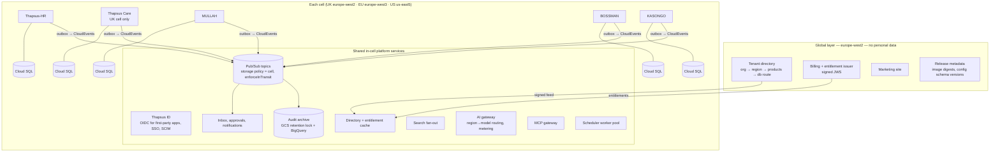

# Research — the Thapsus suite platform

> Research dossier prepared on 2026-11-07 for `SUITE_PLAN.md`, `PLATFORM.md`, `STUDIO.md`, `AI.md` and `DESIGN_SYSTEM.md`.
> Markers: [V] verified on an official page in this session; [S] secondary source; [U] unverified or from prior knowledge;
> [A] analysis or recommendation. Google Cloud facts were checked against the official pages on 2026-11-07.
> Where this dossier and the plan differ, the plan records the reason. Two differences: the plan names packages
> `@thapsus-suite/*` (Thapsus-HR already uses `@thapsus/*` for its own packages), and it keeps one accent per product
> because the owner chose that on 2026-11-07 (§5.4 here suggests one suite accent).


**Prepared:** 2026-11-07 · **Scope:** the cross-cutting platform shared by Thapsus-HR, Thapsus Care, MULLAH (finance), BOSSMAN (CRM) and KASONGO (ERP) · **Audience:** product owner and the engineers of the five repositories.

## How to read this

Every factual claim carries a marker:

| Marker | Meaning |
| --- | --- |
| **[V]** | Verified in this session against the official page or primary text cited; "checked 2026-11-07" unless another date is given. For Google Cloud pages the page's own "Last updated" date is quoted. |
| **[S]** | Read in this session, but only in secondary sources (law-firm alerts, vendor blogs, trackers). Treat as probable, not settled. |
| **[U]** | From prior knowledge; not re-checked in this session. The shared web-search budget for this run was exhausted part-way through, so several vendor descriptions in sections 1, 2 and 5 rest on this. Verify before relying on them. |
| **[A]** | My analysis or recommendation, not a fact. |

The product context (stack, cells, regions, policies) given in the brief was taken as fact and not re-researched. Where this dossier finds that a context assumption no longer holds (for example a Google service that is missing in a cell region), it says so.

---

## 0. Executive summary

**The five most important findings**

1. **Several Google Cloud services the suite would naturally use are missing in us-east5.** Cloud Scheduler and Cloud Tasks are not offered in us-east5 at all [V, pages updated 2026-10-26]. Thapsus-HR's cell module creates its drain scheduler job in the cell's own region, so the US cell will need an in-application scheduler (a Cloud Run worker pool or pg-boss cron) instead. Document AI has no us-east5 location; Eventarc Advanced, Cloud Run GPUs and the newest Gemini and Claude models are also absent from the cell regions (section 3).
2. **No Claude model runs in the UK, and no Claude model runs on a London or Frankfurt endpoint.** Regional Claude endpoints exist only in us-east5, europe-west1 and asia-southeast1, and only for Claude Sonnet 4.6, Opus 4.6/4.5, Haiku 4.5 and older; every newer Claude model is served only from the global or `us`/`eu` multi-region endpoints [V]. The `eu` multi-region explicitly excludes the UK [V]. In-country ML processing in London is listed only for Gemini 4 Argon, Gemini 3.5 Flash, Gemini 2.5 Flash (128k) and two text-embedding models; in Frankfurt for Gemini 3.5 Flash and Gemini 2.5 Flash (128k) [V]. The suite's AI gateway must route by region, and the UK will be Gemini-only if processing must stay in the UK.
3. **Build one configuration engine, not five.** All the mature platforms (Salesforce, Dataverse, ServiceNow, NetSuite, Odoo) converge on the same pieces: metadata-defined objects and fields, layouts, a safe expression language, record-triggered automation with approvals, field-level security, packaged and versioned configuration, and a layering model that keeps vendor upgrades from overwriting customer changes [A, built on [V]/[U] vendor facts]. Use **CEL** as the one expression language (typed, non-Turing-complete, implementations in Go, Java, C++ and two maintained JavaScript ports) [V for the JavaScript packages].
4. **Integrate products with "system of record per data type" plus CloudEvents over regional Pub/Sub, not a golden-record hub.** A hub adds a sixth product that must itself honour residency, RLS and audit. Odoo and Workday get consistency from a single database and object model, which Thapsus has already ruled out by having five codebases. Microsoft and SAP add distribution layers (Dataverse/dual-write; Master Data Integration) because their suites grew by acquisition, the same situation as Thapsus [A].
5. **Regulatory dates have moved.** The EU AI Act's Annex III high-risk obligations now apply from **2 December 2027**, and Annex I (product-embedded) obligations from 2 August 2028. Regulation (EU) 2026/1744 entered into force on 27 July 2026 [V for the Commission news item]. Article 50 transparency applies from 2 August 2026 [S]. Colorado repealed SB 24-205 and replaced it with SB 26-189, effective 1 January 2027 [S]. California's ADMT rules require compliance by 1 January 2027 [S]. The EU Data Act bans switching charges from **12 January 2027** [V, Article 29(1)]. NIS2 Recital 33 expressly names SaaS as a cloud computing service [V].

**Recommended suite architecture (summary; detail in 2.10)**

- One **cell per home region**: UK europe-west2, EU europe-west3, US us-east5. Each cell runs every product the region offers as an independent Cloud Run service with its own Cloud SQL database, plus a small set of shared in-cell platform services: identity and session, org/entitlement cache, event bus, inbox and approvals, audit archive, search fan-out, AI gateway and MCP gateway. The global layer in europe-west2 holds only the tenant directory (org → region → products), billing/entitlements, marketing and release metadata, and no personal data.
- **Shared code, minimal shared runtime.** A versioned `@thapsus/platform-*` package family covers tenant-context DB access, residency-guarded clients, the configuration engine, outbox and CloudEvents, audit, i18n, logging, tokens, UI and the shell. Every product stays sellable and deployable alone.
- **Each data type has one owning product.** Products integrate through thin CloudEvents on regional Pub/Sub (message storage policy pinned to the cell region and `enforceInTransit` on) plus API reads. Global URNs make cross-product references stable.
- **One organisation has one home region across all products.** A UK-only customer is simply an org in the UK cell; Care is offered only there. A group spanning regions is several orgs linked in the directory, with no personal data crossing cells.
- **One design-token source** in DTCG 2025.10 format, built with Style Dictionary 5. It feeds a shared app shell with an app switcher, and the products stay separate Next.js apps rather than micro-frontends.

---

## 1. No-code configuration platforms

### 1.1 How the leading platforms implement customer configuration

#### Salesforce (Platform / Lightning)

- **Metadata-driven multitenancy.** Object and field definitions live as metadata in a Universal Data Dictionary (`MT_Objects`, `MT_Fields`), not as physical DDL. A kernel interprets that metadata at runtime, and there is a "clear separation of the Salesforce-managed kernel from tenant-managed metadata" [V, https://architect.salesforce.com/fundamentals/platform-multitenant-architecture].
- **Storage of tenant fields.** All record values sit in one shared `MT_Data` table with generic "flex" columns (`Value0…ValueN`, stored as variable-length strings in a canonical format). `MT_Fields` maps each custom field to a slot. Indexes are not built on flex columns. Values marked for indexing are copied into typed pivot tables (`MT_Indexes` with `StringValue`/`NumValue`/`DateValue`, `MT_Unique_Indexes`, `MT_Relationships`) [V, same page]. This pattern is the ancestor of the "index slot" table recommended in 1.9.
- **Customisation surface [U].**
  - Data model: custom objects and fields (`__c` suffix), record types (picklist subsets and layouts per business process).
  - UI: page layouts, Lightning App Builder and Dynamic Forms.
  - Logic: validation rules and formula fields in an Excel-like formula language.
  - Automation: Flow (record-triggered, scheduled, screen and autolaunched flows). Workflow Rules and Process Builder were retired in favour of Flow; Salesforce announced end of support on 31 December 2025.
  - Approvals: approval processes, plus Flow-based orchestration.
  - Security: profiles, permission sets and permission-set groups, field-level security, and sharing rules for record-level access.
- **Lifecycle [U].**
  - Sandboxes come in four types: Developer, Developer Pro, Partial Copy and Full.
  - Change sets and the newer DevOps Center move metadata between orgs; the Metadata API and Salesforce CLI support source-driven development.
  - Managed packages (first- and second-generation) carry a namespace, protect their components and are upgraded in place. Unlocked packages serve internal modularity. AppExchange requires a security review.
- **Upgrade safety.** Salesforce "reruns the unit tests for every application with each development release of the platform" to learn whether new features break existing applications, and requires 75 % Apex test coverage before production deployment [V, architecture page]. Governor limits cap CPU, heap, queries, DML and callouts per transaction, so no tenant can monopolise shared resources [V].
- **Pro-code.** Apex, a proprietary Java-like language with governor limits; Lightning Web Components, a standards-based web-component UI layer [U].

#### Microsoft Power Platform and Dataverse

- **Data model and logic [U].** Tables (formerly entities), columns, relationships, choices (option sets), model-driven forms and views, and business rules (no-code conditions and actions that run on forms or the server). Formula columns use Power Fx. Power Automate cloud flows have Dataverse triggers and an approvals connector. Plug-ins are registered .NET code that runs sandboxed.
- **Solutions and layering [V, https://learn.microsoft.com/en-us/power-platform/alm/solution-layers-alm].**
  - Components are layered: the system layer at the base, then managed solutions (the last installed sits on top), then a single unmanaged layer for ad-hoc customisations.
  - Model-driven apps, forms and site maps merge across layers. Every other component uses "top wins".
  - Uninstalling a managed solution reveals the layer beneath.
  - Upgrades are staged as a pending `_Upgrade` layer and then flattened.
  - This is the clearest public description of an upgrade-safe customisation model, and Thapsus should copy its concepts (1.7).
- **ALM [U].** Environments (dev, test, production), Managed Environments, pipelines in Power Platform, solution segmentation, and the Common Data Model (open schemas) for interoperability.

#### ServiceNow (Now Platform, App Engine)

- **Customisation surface [U].** Everything is a table in a dictionary. Tables extend base tables such as `task`. Logic comes from UI policies, client scripts and server-side business rules (JavaScript). Flow Designer (now Workflow Studio) provides automation. App Engine Studio serves low-code builders and ServiceNow Studio serves developers.
- **Movement and isolation [U].** Update sets record customer changes as XML (`sys_update_xml`) and move them between instances. Scoped applications get their own namespace, cross-scope access controls and versioned publishing through the Application Repository and the Store. Global-scope customisations are the hardest to upgrade.
- **Upgrade safety [U].** When a release changes a record the customer has customised, the upgrade skips that record and lists it as a "skipped record" for the customer to review and merge. Thapsus should copy this explicit upgrade-conflict report (1.7).

#### Oracle NetSuite (SuiteCloud)

- **Customisation surface [U].** SuiteBuilder covers custom records, custom fields (entity, transaction, item, CRM), custom forms, saved searches and centres. SuiteFlow provides state-machine workflows with approval patterns. SuiteScript 2.1 is JavaScript metered in governance units per script type. SuiteTalk provides SOAP and REST APIs.
- **Lifecycle [U].** The SuiteCloud Development Framework (SDF) packages customisations as account-customisation projects or SuiteApps, alongside the legacy SuiteBundler. Sandbox and release-preview accounts let customers test the twice-yearly releases.

#### Odoo (Studio)

- **Customisation surface [U].** Studio (Enterprise edition) adds fields (prefixed `x_studio_`), models, views (stored as inherited XML views), automations (server actions), approvals, QWeb PDF reports and new apps.
- **Upgrade safety [U].** Customisations can be exported as an installable module. Odoo's upgrade service migrates Studio customisations between major versions. Odoo.sh provides staging branches.
- **Data model [U].** All Odoo apps share one database and ORM, so `res.partner`, `product.product` and `res.company` are inherently shared. This explains its suite coherence (2.1).

#### Creatio [U]

- A no-code platform for CRM and workflow: Freedom UI designer, a BPMN process designer, case management, packages and a marketplace.
- Configuration lives in packages that are moved between environments. It is positioned as "composable" no-code apps on a shared data model.

#### Zoho Creator [U]

- A low-code app builder with forms, reports, pages and the Deluge scripting language.
- It has development, stage and production environments, and integrates natively with other Zoho apps. Zoho One bundles 40+ apps behind one directory and admin panel.

#### HubSpot [U]

- Custom objects (Enterprise tiers), custom properties, pipelines and stages.
- Workflows include custom-coded actions in Node.js or Python (Operations Hub) and webhook actions.
- Standard and developer sandboxes, plus a developer-platform "projects" model for app cards and UI extensions.

#### Airtable [U]

- Bases and tables with typed fields (formula, lookup, rollup, linked record), interfaces (a no-code UI builder) and automations, including a "run script" action (JavaScript with time limits). Sync spans bases.
- Governance and promotion between environments are weak compared with the enterprise platforms. This illustrates the cost of not designing the configuration lifecycle in from the start.

### 1.2 Patterns that recur, and pitfalls

| Pattern | Seen in | Lesson for Thapsus [A] |
| --- | --- | --- |
| Metadata stored as data, interpreted at runtime | Salesforce [V], Dataverse, ServiceNow, Odoo | Configuration must be tenant-scoped rows under RLS, not DDL per tenant. |
| Typed index side-tables for custom fields | Salesforce `MT_Indexes` [V] | Postgres JSONB plus a typed index-slot table gives the same benefit without flex columns. |
| One canonical expression language for formulas, validation and conditions | Salesforce formulas, Power Fx, NetSuite formulas | One language (CEL) used everywhere, so administrators learn it once. |
| Record-triggered automation replacing older rule engines | Salesforce Flow (Workflow Rules and Process Builder retired) [U] | Start with one automation model and avoid parallel engines. |
| Layered, packaged configuration with vendor/customer separation | Dataverse layers [V], Salesforce managed packages, ServiceNow scopes | Vendor, solution-pack and customer layers, with explicit merge rules. |
| Explicit upgrade-conflict reports | ServiceNow skipped records [U] | A per-tenant "upgrade impact report" before each release. |
| Vendor re-runs customer tests before releases | Salesforce [V] | Replay every tenant's configuration (type-check, simulate) in CI before release. |
| Resource governors per transaction | Salesforce governor limits [V], NetSuite governance units [U] | Quotas on expression cost, workflow steps, script fuel and API calls per tenant. |
| Sandboxes as copies of production configuration | Salesforce, HubSpot, NetSuite, Dataverse | Sandbox = a separate tenant in the same cell (keeps residency). Copy configuration plus fictional or masked data, never raw production personal data by default. |

**Pitfalls to avoid [A]**

- Two automation engines living side by side (Salesforce's decade-long migration).
- Customer edits to vendor components without layering, which makes ServiceNow-style global customisations painful to upgrade.
- Per-tenant DDL, which causes migration drift and breaks "move a big tenant to its own database without code changes".
- An untyped expression language, which leads to runtime errors after upgrades.
- Unbounded scripts with network access (exfiltration risk and residency breach).

### 1.3 Capability list for a shared Thapsus configuration platform

Phase guide: **M** = minimum for the first product to adopt it, **N** = next, **L** = later [A].

| # | Capability | Phase | Design notes [A] |
| --- | --- | --- | --- |
| C1 | Custom fields on standard objects (text, number, money, date, date-time, boolean, picklist, multi-picklist, lookup, user, URL, email, phone, long text, file) | M | Stored in `custom jsonb` on the owning row. Money stored as integer minor units plus an ISO 4217 code. Dates as ISO date strings interpreted with an explicit IANA zone (rule in both repos). |
| C2 | Custom objects with relationships (lookup, master-detail, many-to-many via junction) | N | Generic `custom_record` table per product DB (1.9). Junctions as custom objects. |
| C3 | Picklists: global value sets, dependent picklists, inactive values, translations | M | Values have stable API names; labels go through message catalogues. |
| C4 | Record types / business processes | N | Select the layout, picklist subset and workflow per record type. |
| C5 | Layouts and forms (sections, field order, conditional visibility, read-only rules, related lists) | M | Rendered by `@thapsus/ui` from metadata. Visibility rules in CEL. |
| C6 | List views (columns, filters, sort, sharing to roles) | M | Filters stored as CEL and translated to parameterised SQL over known fields (1.5). |
| C7 | Validation rules | M | CEL boolean plus error message key, field binding, severity (block/warn) and active date range. |
| C8 | Formula fields (calculated on read) and roll-up summaries | N | CEL. Roll-ups maintained by events, not computed on read. |
| C9 | Default values and auto-population | M | CEL expressions with an injected `request.time`. |
| C10 | Numbering sequences | M | Per tenant, object and legal entity, with prefix patterns. Gapless where law requires it (for example invoice numbers, MULLAH), using a counter row locked in the same transaction. Otherwise database sequences. |
| C11 | Workflow automation: triggers, conditions, actions | M | Section 1.6. |
| C12 | Approvals (serial, parallel, quorum, delegation, escalation, separation of duties) | M | Section 1.6. Care requires distinct users, and requester ≠ approver. |
| C13 | SLA timers and business calendars | N | Calendars come from jurisdiction packs (holidays) plus tenant overrides. |
| C14 | Scheduled jobs (tenant cron in tenant time zone) | N | In-cell scheduler (not Cloud Scheduler: absent in us-east5). |
| C15 | Document templates (letters, contracts, invoices, care plans) to PDF/DOCX | N | Logic-less template language with a whitelisted helper library. Rendered in-cell. |
| C16 | Email and notification templates with locale variants | M | ICU MessageFormat. Sent through the regional email provider. |
| C17 | Translation of custom labels (en-GB, en-US first) | M | Labels are message keys. XLIFF/CSV export and import. Fallback chain. |
| C18 | Roles and permissions: permission sets and groups, object CRUD, field-level security, record scope | M | Section 1.8. RLS stays the tenant boundary. Intra-tenant scope is enforced in the API, plus RLS where cheap. |
| C19 | Report builder and dashboards | N | Operational reports in Postgres. Analytical ones in the cell's BigQuery (2.8). |
| C20 | Outbound webhooks and connector framework | N | CloudEvents payloads, HMAC signatures, retries, per-endpoint secrets. Connectors listed as sub-processors before build. |
| C21 | Import mapping (CSV/XLSX) with saved mappings, dry run and error report | M | Idempotent chunked jobs keyed by external ID. Transforms in CEL. |
| C22 | Configuration versioning, change sets and promotion sandbox → production | N | Section 1.7. |
| C23 | Upgrade-safe layering (vendor, solution pack, customer) and an upgrade impact report | N | Section 1.7. |
| C24 | Industry templates / solution packs | L | Signed, versioned metadata packages, distinct from jurisdiction rule packs. |
| C25 | Pro-code: sandboxed scripts, UI extensions, external apps, marketplace | L | Section 1.8. |
| C26 | Audit of every configuration change and every view of sensitive custom fields | M | Same append-only audit as data, with a `config.*` action namespace. |
| C27 | Limits and quotas (fields per object, index slots, expression cost, workflow runs/day, script fuel) | M | Published per plan. Enforced in the engine. |
| C28 | Configuration export (machine-readable) | M | Also an EU Data Act requirement: exportable data includes metadata (section 6). |

### 1.4 Metadata model and runtime [A]

- **Where configuration lives.** Each product's own database holds its metadata tables, which are tenant-scoped with forced RLS: `cfg_object`, `cfg_field`, `cfg_layout`, `cfg_rule`, `cfg_workflow`, `cfg_permission_set`, `cfg_package`, `cfg_version`. This satisfies both repos' rules (tenant_id, forced RLS, policy, tenant-leading index, audit) and means a tenant's configuration moves with the tenant when it is routed to a dedicated database.
- **One format across products.** A shared JSON Schema defines "Thapsus Config Package" documents: objects, fields, layouts, rules, workflows, permission sets, translations, numbering and templates. Every product implements the same loader, validator and differ from `@thapsus/platform-config`.
- **Compiled cache.** On publish, a tenant's configuration is compiled into a version-stamped bundle: type-checked CEL ASTs, a field map and JSON Schema validators. The bundle is cached per process (keyed by tenant and version) and invalidated by a CloudEvent `config.published`.
- **API surface.**
  - Custom fields appear in the REST API under `custom` with stable API names, and are described in a per-tenant `GET /v1/meta/objects/{object}` endpoint.
  - The static OpenAPI 3.1 spec stays tenant-independent and documents `custom` as `additionalProperties` with a schema link. This keeps HR's "route schemas are the source of the spec" rule.

### 1.5 The expression language: CEL compared with alternatives

| Criterion | **CEL** (Common Expression Language) | **JSONLogic** | Power Fx | Jexl-style JavaScript DSLs | Embedded JavaScript (QuickJS/isolates) |
| --- | --- | --- | --- | --- | --- |
| Safety | Non-Turing-complete. Comprehension macros (`all`, `exists`, `map`, `filter`) are bounded by input size [U, spec] | Terminates. JSON abstract syntax tree | Formula language, no loops [U] | Varies. Some libraries have had injection CVEs (not verified here) | Turing-complete. Needs fuel, memory and time limits |
| Types | Static type-checking against declared variables [V, cel-js `Environment.check`] | Untyped | Typed [U] | Mostly untyped | Untyped unless TypeScript is compiled |
| Cost control | cel-go has static cost estimation and runtime cost limits [U]. JavaScript ports offer parse-time structural limits only [V] | None needed beyond input-size caps | n/a | Rarely | Interrupt handlers, memory caps, Wasm fuel |
| Implementations | Go, Java, C++ (Google) [U]. JavaScript: `@marcbachmann/cel-js` 8.0.0 (2026-07-07, MIT, zero-dependency, `Environment` with typed variables, custom functions and `limits` {maxAstNodes, maxDepth, maxListElements, maxMapEntries, maxCallArguments}) [V npm]. `@bufbuild/cel` 0.6.2 (2026-11-04, Apache-2.0, maps protobuf well-known types, extension libraries) [V npm] | `json-logic-js` 2.0.5, last published 2024-07-09 [V npm] | .NET only (MIT) [U] | JavaScript only | `quickjs-emscripten` 0.32.0 (2026-02-16, MIT) [V npm] |
| Readability for admins | Familiar C/JavaScript-like syntax (`record.amount > 1000 && record.country == 'GB'`) | Poor by hand; fine behind a visual builder | Excel-like, best for business users [U] | Good | Developers only |
| Where it is used in industry | Kubernetes admission policies, Google Cloud IAM conditions, Envoy, Buf protovalidate [U] | Many rule builders | Power Apps, Dataverse formula columns [U] | Ad hoc | Shopify Functions (Wasm), Figma plugins [U] |
| SQL translation for filters | Feasible for a subset (comparison, logical, `in`, `startsWith`) | Feasible | n/a | Feasible | No |

**Recommendation [A]**

- Make **CEL the single expression language** for validation rules, formula fields, defaults, visibility, workflow conditions, approval routing and list filters.
- Store both the source text and the checked AST. A visual rule builder emits CEL, so there is one runtime.
- Evaluate in TypeScript with `@marcbachmann/cel-js`, or `@bufbuild/cel` if conformance matters more than speed. Run the CEL conformance tests that apply to the chosen library in CI.
- **Sandboxing and cost.** CEL has no I/O, so the risks are CPU and memory from large inputs and comprehensions. Wrap evaluation with:
  - the library's structural limits;
  - caps on list and string sizes in the bound context;
  - an AST-walk cost estimator (node count × declared maximum collection sizes, the cel-go approach) with a per-plan budget, rejected at publish time;
  - a wall-clock guard on bulk evaluations, such as imports.
- **Deterministic function library.** Never call `now()`; inject `request.time`. Date and time functions come from the shared time utilities (IANA zone required). Money arithmetic works on minor units with the currency code checked. No locale-dependent formatting inside expressions (formatting belongs to the UI).
- **Type environment per object version.** A field rename or type change in a vendor release then shows up as a type-check failure in the pre-release configuration replay (1.7), not as a runtime error in production.

### 1.6 Workflow automation, approvals and timers [A]

| Element | Recommended scope |
| --- | --- |
| Triggers | Record created, updated (with a CEL "changed" condition) or deleted, taken from each product's transactional outbox. Scheduled (tenant cron, tenant zone). Relative date ("30 days before `contract_end`"). Inbound webhook (signed). Manual button. Approval outcome. Cross-product CloudEvent from the same cell. |
| Conditions | CEL over `record`, `old`, `user`, `tenant`, `request`. |
| Actions | Update or create record. Send notification or email (template). Create task or approval. Call webhook. Invoke connector. Run sandboxed script (pro-code, later). Wait for a duration or until a condition. Branch. Bounded loop over related records. Publish a CloudEvent to another product in the cell. |
| Approvals | Serial and parallel steps, quorum, delegation and out-of-office, escalation after an SLA, recall, comments, separation-of-duty constraints (approver ≠ requester and ≠ preparer; Care's two-person rules), approver resolution by role, manager chain or CEL. |
| SLA timers | Business-hours calendars from jurisdiction packs plus tenant calendars. Pause and resume. Breach events. |
| Runtime | A durable state machine in each product's own Postgres: `wf_definition`, `wf_instance`, `wf_step`, `wf_timer`, executed by queue workers (pg-boss in Care; the same pattern in the others) inside the cell. Do not use Cloud Tasks (absent in us-east5) or Eventarc Advanced (absent in europe-west2 and us-east5) [V]. Google Workflows is available in all three regions [V], but its executions are not tenant-RLS-protected, so keep it for infrastructure orchestration only. |
| Safety | Idempotency key per step. Recursion guard (an origin marker on writes made by automation; maximum depth). Per-tenant concurrency and daily run quotas. Definitions are versioned and running instances stay pinned to their start version. Test mode in the sandbox with a dry-run trace. Every run is audited. |

### 1.7 Configuration versioning, promotion and upgrade safety [A]

1. **Layers.** Each component's effective definition is computed Dataverse-style [V for the Dataverse model]:
   - `vendor` (shipped with the product release, namespace `th`);
   - `pack` (industry or solution packs, namespace per pack);
   - `customer` (the tenant).

   Scalar properties use "top wins". Layouts and forms merge (customer additions survive vendor changes). Vendors mark each property of a vendor component as *customer-overridable* or *locked*, the equivalent of Dataverse "managed properties".
2. **Change sets.** Every edit in the configuration UI goes into a draft change set. Publishing validates (schema, CEL type-check, dependency graph, permission references, cost budget), computes a diff, applies it in one transaction, bumps the tenant configuration version and emits `config.published`. Rollback means publishing the previous version.
3. **Sandboxes.** A sandbox is a sibling tenant in the same cell, flagged `kind = sandbox` in the directory. Creation copies configuration and, optionally, fictional or masked data generated by the same seeders the repos use. Promotion means exporting a signed configuration package from the sandbox and importing it into production with the same validation. Real personal data is not copied by default; a full copy needs an explicit, audited customer instruction as controller.
4. **Upgrade contract.**
   - Vendor metadata API names never change; renames are additive with aliases.
   - Removals follow expand-and-contract over at least two releases.
   - Every release runs a **configuration replay** in CI: each tenant's compiled configuration (anonymised, with no data) is type-checked against the new schema, and a sample of workflows is simulated on fictional data. Like Salesforce's practice of re-running customer tests [V], this catches breakage before deployment.
   - Customers get an **upgrade impact report** listing the components where a vendor change was masked by their override (ServiceNow's "skipped records" idea [U]).
5. **Git option.** Large customers can sync configuration packages to their own Git repository, as with Salesforce DX and Dataverse solutions. Treat it as an optional integration, not the primary path.

### 1.8 Pro-code extension [A]

| Tier | Mechanism | Isolation |
| --- | --- | --- |
| Scripts inside workflows | JavaScript executed in QuickJS compiled to WebAssembly (`quickjs-emscripten` [V npm]) or JavaScript compiled to Wasm and run under a Wasm runtime with fuel or epoch interruption (Shopify Functions run partner code as Wasm modules [V, shopify.dev]) | A separate in-cell Cloud Run service with **no network egress** and no Google credentials. Input is JSON, output is a JSON list of proposed actions that the workflow engine validates and executes. Memory, instruction and time caps. One instance per invocation batch per tenant. |
| UI extensions | Sandboxed iframe or remote-rendered component tree using `@thapsus/ui` primitives, with a postMessage SDK | Keeps visual consistency and prevents DOM access to the host page. |
| External apps | Public `/v1` API with OAuth 2.1, webhooks and MCP (2.9) | Usual API security. App registration per tenant. |
| Marketplace | Later. Listing, security review, data-flow declaration (which region, which sub-processors) and revocation | Mirrors AppExchange review [U]. |

### 1.9 PostgreSQL patterns for tenant-defined fields at scale

**Options compared**

| Approach | Pros | Cons | Verdict [A] |
| --- | --- | --- | --- |
| Per-tenant DDL (`ALTER TABLE … ADD COLUMN cf_123`) | Native types, constraints, statistics | Schema diverges per tenant. Migrations explode. Catalogue bloat. Breaks routing to a dedicated database "without code changes". Locks. | Avoid. |
| EAV (`entity, attribute, value` rows) | Flexible | Type loss, a join per field, pivot cost, row explosion, poor statistics, no constraints. Historically chosen by systems on databases without JSON. | Avoid as primary storage. A typed variant is useful only as an index side-table. |
| Flex columns (`value0…value500 text`), Salesforce-style | Fixed schema | Type coercion everywhere. Wide sparse rows. Needs pivot index tables [V Salesforce]. | Not needed in Postgres. |
| **JSONB column per row** (`custom jsonb`) | One column, typed JSON values, GIN indexing, works with RLS unchanged | No per-key statistics. Expression indexes needed for range and sort. Whole-row rewrite on update (TOAST). | **Primary choice.** |
| **Typed index-slot side-table** | Btree range and sort on any custom field for any tenant. Uniqueness per field. | Extra writes in the same transaction | **Use for fields flagged "filterable", "sortable" or "unique".** |
| **Promoted columns** (real typed column, or stored generated column from JSONB) | Native performance | DDL and a table rewrite for a stored generated column | **Vendor-only**, when a custom field becomes a standard field (expand-and-contract migration). |

**Reference schema sketch [A]**

```sql
-- Standard object: core typed columns + tenant custom fields
ALTER TABLE employee ADD COLUMN custom jsonb NOT NULL DEFAULT '{}'::jsonb;
-- Containment / existence queries across all tenants (@>, ?, jsonpath)
CREATE INDEX CONCURRENTLY employee_custom_gin ON employee USING gin (custom jsonb_path_ops);

-- Custom objects: one generic table per product database
CREATE TABLE custom_record (
  tenant_id  uuid NOT NULL,
  object_id  uuid NOT NULL,               -- cfg_object.id
  id         uuid NOT NULL DEFAULT uuidv7(),  -- PostgreSQL 18; use an app-side UUIDv7 on 17
  name       text NOT NULL,
  owner_id   uuid,
  custom     jsonb NOT NULL DEFAULT '{}'::jsonb,
  created_at timestamptz NOT NULL DEFAULT now(),
  updated_at timestamptz NOT NULL DEFAULT now(),
  PRIMARY KEY (tenant_id, id)
);
CREATE INDEX ON custom_record (tenant_id, object_id, name);
ALTER TABLE custom_record ENABLE ROW LEVEL SECURITY;
ALTER TABLE custom_record FORCE ROW LEVEL SECURITY;
CREATE POLICY tenant_isolation ON custom_record
  USING (tenant_id = current_setting('app.tenant_id')::uuid)
  WITH CHECK (tenant_id = current_setting('app.tenant_id')::uuid);

-- Typed index slots for filterable/sortable/unique custom fields (any object, any tenant)
CREATE TABLE custom_field_index (
  tenant_id uuid NOT NULL, field_id uuid NOT NULL, record_id uuid NOT NULL,
  text_value text, num_value numeric, date_value date, ts_value timestamptz, ref_value uuid,
  PRIMARY KEY (tenant_id, field_id, record_id)
);
CREATE INDEX ON custom_field_index (tenant_id, field_id, num_value);
CREATE INDEX ON custom_field_index (tenant_id, field_id, date_value);
CREATE INDEX ON custom_field_index (tenant_id, field_id, lower(text_value) text_pattern_ops);
CREATE UNIQUE INDEX ON custom_field_index (tenant_id, field_id, text_value)
  WHERE text_value IS NOT NULL AND field_id IN (/* maintained list of unique fields, or a flag column */);
-- same RLS enable/force/policy as above
```

**Operational guidance**

- **Statistics.** The planner has no per-key statistics for JSONB, so selectivity estimates for `custom->>'x'` predicates default to constants. For hot keys, create **extended statistics on expressions** (`CREATE STATISTICS … ON ((custom->>'region')) FROM employee`, available since PostgreSQL 14 [U]) or move the field into the index-slot table.
- **Avoid thousands of partial indexes per tenant.** Per-tenant partial expression indexes (`… WHERE tenant_id = '…'`) look attractive but scale badly: the planner considers every index, and DDL is needed per tenant. Reserve them for the few largest tenants. Better still, route those tenants to their own database (already a requirement in HR) and add ordinary expression indexes there.
- **PostgreSQL 18** is now Cloud SQL's default version [V, page updated 2026-11-03]. Three changes matter here [V, PostgreSQL 18 release notes]:
  - btree **skip scan** lets multicolumn indexes such as `(tenant_id, field_id, num_value)` serve queries that omit a leading column;
  - generated columns are now **virtual by default**: be explicit with `STORED` for promoted columns. My understanding (not verified) is that virtual generated columns cannot be indexed in PostgreSQL 18;
  - `uuidv7()` is built in.
- **Write amplification.** Updating one custom field rewrites the whole JSONB value and, if it is large, its TOAST chunks. Cap custom-field payload size per row (for example 32 KB) and keep long text and files in separate tables or object storage.
- **Search.** Fields flagged "searchable" feed a `tsvector` in a per-product search table, plus `pg_trgm` for fuzzy matching (HR's rule: Postgres full-text search plus pg_trgm only).
- **RLS stays intact.** Every new table above carries `tenant_id`, forced RLS, a policy and a tenant-leading index, and is picked up by the existing isolation tests, which enumerate every table. Custom data never lives outside tenant-scoped tables.
- **Field-level security.** Enforce it in the API projection layer from compiled permission sets. A custom field classified as special-category (health, diversity, immigration in HR; health data in Care) must **not** go in `custom jsonb`. The configuration engine stores it in the existing encrypted sensitive-data store, with per-access audit. The field metadata carries `classification` and the engine refuses to create a sensitive field without it.
- **Audit.** The application-level audit records field-level diffs using field IDs, never labels. For JSONB, compute `jsonb` key diffs in the same transaction. Configuration changes are audited like data changes (`config.field.created`, `config.rule.published`).
- **Effective dating.** For effective-dated objects (HR core data), `custom` lives on the effective-dated row, so custom values are effective-dated too. This is consistent with HR's `valid_from`/`valid_to` exclusion constraints.

---

## 2. Suite interoperability

### 2.1 How large suites make products work together

| Vendor | Integration model | Master data approach | Notes |
| --- | --- | --- | --- |
| **Microsoft (Dynamics 365 / Power Platform)** | Customer engagement apps share Dataverse. Finance and Operations has its own database, bridged by dual-write and virtual tables [U] | Common Data Model: open, shared entity schemas (Account, Contact, Worker…) published on GitHub [U] | Shared identity (Entra ID) and admin centre. Solutions layered across apps [V for layering]. |
| **SAP** | Integration through SAP BTP: SAP Master Data Integration distributes master data between S/4HANA, SuccessFactors, Ariba and others; SAP One Domain Model defines aligned entities (business partner, cost centre, workforce person) [U] | Federated distribution: each application keeps its own store, and MDI replicates and keys records [U] | Single sign-on through SAP Cloud Identity Services. Fiori launchpad as the shared shell; Horizon theme across apps [S]. |
| **Oracle Fusion Cloud** | Applications built on one common platform and data model (ERP, HCM, SCM, CX) [U] | Shared "Trading Community Architecture" for parties; shared enterprise structures (legal entities, ledgers, business units) [U] | Built as a suite from the start, so less integration plumbing. |
| **Workday** | A single object model and one codebase for HCM, Financials and Planning [U] | One store: a worker is the same object everywhere [U] | Workday Extend for customer apps. Customers run one version. |
| **Zoho One** | 40+ separate apps with one directory, one admin panel and SSO, joined by built-in integrations and Zoho Flow [U] | Mostly app-owned data with sync; unified analytics in Zoho Analytics [U] | The closest commercial analogue to Thapsus's situation (separate products, one brand). |
| **Odoo** | One database, one ORM, one process [U] | Inherently shared (`res.partner`, `product`, `res.company`) [U] | Maximum coherence, but every app must be deployed together. Not compatible with separately sold, separately deployed products. |
| **Freshworks** | Separate products (Freshdesk, Freshservice, Freshsales) on shared platform services: identity, admin, analytics, AI (the "Neo" platform) [U] | Shared account and contact services across products [U] | A "platform services + products" model. |

**Takeaway [A].** Suites built as one codebase (Odoo, Workday, Oracle Fusion) share a data model natively. Suites grown from separate products (Microsoft, SAP, Zoho, Freshworks) add a **shared identity and admin layer**, **published common schemas** and **an integration fabric**, and keep data owned by each app. Thapsus is in the second group: two products already exist in separate repositories with different stacks (Fastify versus Hono, Better Auth in Care).

### 2.2 Unified identity and organisation model [A]

- **One Thapsus organisation (org) has one home region.** An org can hold entitlements to one to five products. A user belongs to an org and has a per-product role assignment.
- **Identity lives in the cell, not in the global layer.** User identifiers (emails) are personal data, and the global layer must hold none. HR already handles "find my workspace" by fanning out to cells [V, repo `docs/ARCHITECTURE.md`]. Extend that pattern:
  - a per-cell **Thapsus ID** service issues sessions and OIDC tokens to Thapsus's own apps in that cell, so signing in once in the UK cell gives access to HR, Care and the others there;
  - customer SSO (SAML 2.0 or OIDC to the customer's IdP) is configured once per org;
  - **SCIM 2.0** (RFC 7643/7644) is provisioned once per org, with product licences and roles mapped from IdP groups.
- **Scope guardrail.** HR's CLAUDE.md puts "acting as an identity provider for other apps" out of scope. An OIDC provider used only by Thapsus's own first-party apps is internal SSO, not an IdP for third parties. Record this in an ADR so later "Sign in with Thapsus" requests are recognised as out of scope.
- **Converging the stacks.** Care uses Better Auth and HR has its own session and MFA stack. Rather than rewriting either now, define the **Thapsus ID contract** (OIDC discovery, token claims `org`, `tenant`, `region`, `products`, `amr`, session lifetimes, MFA and step-up semantics) and let each product be a relying party. Either product's stack can then be promoted to be the cell IdP. Care's stricter rules (NCSC passwords, step-up for controlled drugs, passkeys and TOTP) become per-product policies on top.
- **Google Identity Platform is not a fit for end-user identity here.** It does not appear in Google's list of services that support data residency [V, https://cloud.google.com/terms/data-residency, last modified 8 September 2026].

### 2.3 Tenant directory spanning products and regions [A]

The global directory (europe-west2, no personal data) holds:

- `org_id`, `slug`, `home_region` (`uk`/`eu`/`us`), `kind` (production or sandbox), `status`;
- `products[]`, each with a `product_tenant_id` and that product's `db_route` key, so each product's tenant-to-database routing stays configuration (HR rule);
- `group_id` for multi-org groups, billing account reference and entitlement version.

Each cell holds a read-only replica of the rows for its own orgs, delivered by a signed feed. Cross-product calls then resolve locally, with no global hop on the request path.

### 2.4 Entitlements and licensing [A]

- **Billing and entitlement issuance stay global.** They hold no personal data; payment-card data stays with the payment provider, for example Stripe, keeping PCI scope minimal.
- **Entitlements are signed documents.** Each is a JWS listing products, plan, seat limits, add-ons (AI credits, extra sandboxes) and feature flags, versioned, cached in each cell and verified locally.
- **Seat counting runs in-cell.** Products report active-seat counts (numbers only) upward.
- **Feature flags go through OpenFeature** (already Care's default) with a Thapsus provider that reads entitlements plus operational flags.

### 2.5 Cross-product event bus [A]

- **Envelope: CloudEvents 1.0.x** [U for version detail]. Required attributes: `id`, `source` (`urn:thapsus:{product}:{region}`), `type` (`com.thapsus.hr.employee.updated.v1`), `specversion`, `time`. Thapsus extension attributes: `tenantid`, `orgid`, `region`, `subject` (record URN), `traceparent`. JavaScript SDK `cloudevents` 10.0.0 (Apache-2.0) [V npm].
- **Contracts: AsyncAPI 3.x documents per product**, published like the OpenAPI specs and contract-tested (`@asyncapi/parser` 3.6.6, Apache-2.0, 2026-10-16) [V npm]. Pub/Sub schemas can enforce payload shape at publish time [U].
- **Transport: Pub/Sub, one set of topics per cell.**
  - Every topic sets `messageStoragePolicy.allowedPersistenceRegions = [cell region]` and `enforceInTransit = true`. With that flag set, publish, pull and streaming-pull requests received in a non-allowed region are rejected, and push delivery happens only in allowed regions [V, https://docs.cloud.google.com/pubsub/docs/resource-location-restriction, updated 2026-10-26].
  - Topics created without a policy inherit it from the Resource Location Restriction org policy, and `enforceInTransit` from the "Enforce in-transit regions for Pub/Sub messages" org policy [V].
  - Policy changes do **not** propagate to existing topics or move already-stored messages, and the policy covers message contents only, not topic names or labels [V]. So never put personal data in topic names, labels or attributes.
- **Outbox to Pub/Sub relay.** Each product writes domain events to its own outbox in the business transaction (HR rule; Care uses outbox events between modules). A relay worker publishes them, consumers are idempotent (keyed by `id`), and ordering keys use the record URN when order matters.
- **Thin events.** Payloads carry IDs, changed field names and the minimum data needed. Consumers fetch details through the owning product's API under the caller's permissions. This minimises personal data in transit and keeps one permission check.
- **No cross-cell events.** Events never leave a cell. A group spanning regions integrates only through non-personal aggregates or explicit controller-approved exports.

### 2.6 Shared master data: golden-record hub versus system of record per type

| Model | How it works | Pros | Cons |
| --- | --- | --- | --- |
| **Golden-record hub (MDM)** | A central service stores the authoritative copy, matching and merging duplicates and publishing to apps | One place for quality rules. Cross-app deduplication. | A sixth product to build. It must hold personal data per cell with RLS, audit and residency. Write contention. Products lose autonomy. Hard to sell products separately. |
| **System of record (SoR) per data type** | Each type has one owning product. Others hold references (URN) plus cached projections updated by events | Matches separate products. Clear ownership. Each product works alone. | Cross-product deduplication needs a matching service later. Projections can go stale (mitigated by events and version checks). |
| **Hybrid (recommended later)** | SoR per type, plus a lightweight in-cell **cross-reference and matching service** that links equivalent records (for example a CRM account and a finance customer) without owning them | Adds dedup when needed | Extra service, deferred until two products overlap on parties. |

**Recommendation [A]:** start with **SoR per type plus a shared reference-data service**, add the cross-reference service when BOSSMAN and MULLAH both ship.

| Data type | Owner (SoR) | Consumers | Notes |
| --- | --- | --- | --- |
| Employees, workers, org units, positions, managers | Thapsus-HR | All | Care keeps its own workforce context. When both products are bought, Care staff records reference HR workers by URN. |
| Legal entities, chart of accounts, cost centres, tax codes, fiscal calendars | MULLAH | HR, BOSSMAN, KASONGO | When MULLAH is not bought, each product keeps a minimal local list that can later be linked. |
| Currencies, FX rates, countries, time zones, units of measure | **Shared reference-data service** (vendor-curated plus tenant overrides) | All | Non-personal. One versioned package per release, plus a tenant overlay. |
| Customers (B2B accounts) and contacts | BOSSMAN | MULLAH (receivables), KASONGO (sales orders) | Matching to MULLAH customers via the cross-reference service. |
| Suppliers | MULLAH (payables) or KASONGO (procurement), by configuration | Both | Pick one owner per org at onboarding. |
| Products and items, warehouses, bills of materials | KASONGO | BOSSMAN (quotes), MULLAH (revenue) | |
| Locations (sites, care homes) | The product that creates them. Care owns CQC locations | HR (work locations) | Shared `location` URN. |
| Residents and people supported (Care) | Thapsus Care | **Nobody else** | Health and social-care data is not shared across products by default. |

### 2.7 Navigation, search, notifications, approvals and audit across products [A]

- **Navigation.**
  - A shared `@thapsus/shell` package provides the sidebar, top bar, **app switcher** (entitled products only), org switcher, notifications bell, global search box, help and user menu.
  - Products sit on per-region, per-product hosts (for example `hr.uk.<domain>`; the product domain is not yet chosen, per HR's `THAPSUS_HR_DOMAIN` rule).
  - Moving between products is a normal navigation with SSO from the cell's Thapsus ID. No module federation.
- **Unified search is federated within the cell.** The shell calls each entitled product's `/v1/search` (Postgres full-text search plus `pg_trgm`) in parallel with the user's token. Each product filters by its own permissions, and the shell merges results by product and type. Avoid a central index at first: it would duplicate personal data and permission logic.
- **Unified inbox and approvals.** An in-cell inbox service subscribes to `*.task.*` and `*.approval.*` events and stores task cards (title key, deep link, due date, status, owning product). Approving from the inbox calls the owning product's API, which re-checks permissions and separation of duties.
- **Notifications.** Email goes through the in-region provider (HR uses SES in-region). Web Push to the PWA passes through browser vendors' global push services, so push payloads must be encrypted, generic and free of personal data (for example "You have 2 new tasks") [A].
- **Unified audit.**
  - Each product keeps its append-only audit table.
  - A common audit event schema (actor URN, action, object URN, purpose, before/after field-ID list, request ID, IP hash) is exported continuously to an **in-cell audit archive**: a Cloud Storage bucket in the cell region with a retention lock and CMEK, plus a BigQuery dataset in the same region.
  - Customers export one cross-product audit trail per org. The append-only guarantee stays in each product's database (no UPDATE or DELETE grants).

### 2.8 Cross-product analytics [A]

- **Change data capture: prefer Dataflow or an application export over Datastream.** The target is a **BigQuery dataset in the cell region**. BigQuery offers all three regions as single-region locations [V, updated 2026-10-27]. The `EU` multi-region does not store data in London [V] and is forbidden anyway.
  - **Datastream** runs in europe-west2, europe-west3 and us-east5 [V, page updated 2026-11-02], but it is **not** on Google's data-residency services list. BigQuery, Dataflow and Pub/Sub are [V, terms page last modified 2026-09-08].
  - Prefer one of:
    - (a) an application-driven export: outbox CloudEvents → in-cell consumer → BigQuery Storage Write API;
    - (b) Dataflow jobs pinned to the cell region;
    - (c) BigQuery federated queries (`EXTERNAL_QUERY`) against a Cloud SQL read replica in the same region.
  - Use Datastream only after legal review of its data-location terms.
- **Isolation.** Use a dataset per product per cell, with tenant isolation by BigQuery row-level access policies keyed on `tenant_id`. Optionally, large tenants get their own dataset, mirroring their database routing.
- **Semantic layer.** dbt models plus either LookML in **Looker (Google Cloud core)** (instances can be created in europe-west2, europe-west3 and us-east5 [V, page updated 2026-10-26]) or an open-source semantic layer served by the products' own APIs and charts. For a consistent UI, render dashboards in-product with `@thapsus/charts` and use Looker only for power users.
- **Avoid Looker Studio for customer data.** It is not on Google's data-residency service list (it does not appear on the terms page at all [V]).
- **Gemini in BigQuery.** For datasets outside the US and EU jurisdictions, some assistive features (data insights and others) "process globally" [V, https://docs.cloud.google.com/bigquery/docs/gemini-locations, updated 2026-10-27]. **Disable Gemini in BigQuery in the UK cell projects.**

### 2.9 Exposing the suite to customers' AI agents [A unless marked]

- **MCP.** The current Model Context Protocol revision is **2026-07-28**. It brings a stateless protocol core, header-based routing, cacheable list results, a formal extensions framework and authorization hardening. Clients must use OAuth 2.0 Resource Indicators (RFC 8707), servers publish Protected Resource Metadata (RFC 9728), and issuer validation follows RFC 9207 [S, official MCP blog and specification pages surfaced by search: https://blog.modelcontextprotocol.io/posts/2026-07-28/ and https://modelcontextprotocol.io/specification/2026-07-28/basic/authorization]. TypeScript SDK `@modelcontextprotocol/sdk` 1.32.2 (MIT, 2026-10-23) [V npm].
- **Design.**
  - Run one **MCP server per product per cell** behind an in-cell MCP gateway. Tools map to existing `/v1` operations; there is no separate data path.
  - OAuth tokens come from the cell's Thapsus ID, with scopes mapped to permission sets.
  - The tenant admin switch "external AI agents" is off by default.
  - Tools are read and search first. Write tools create **drafts or proposals** that a human approves in the app (Care rule: AI output never changes state without a human).
  - Every call is rate-limited and audited.
- **Residency boundary.** The MCP server runs in-cell. Data it returns goes to the customer's chosen agent and model provider; that is the customer's decision as controller. Document it in the DPA and the admin UI, and keep the switch off by default.
- **A2A (Agent2Agent).** Reported at v1.0 (March 2026) under Linux Foundation governance, with signed Agent Cards [S]; JavaScript SDK `@a2a-js/sdk` 1.3.0 (Apache-2.0) [V npm]. Relevant only if Thapsus later exposes its own agents (for example an HR policy assistant) to customer agent platforms. Low priority.

### 2.10 Recommended architecture for five products, bought separately or together [A]



| Concern | Decision |
| --- | --- |
| Deployment unit | Each product is its own deployable (Cloud Run services and worker pools) with its own database cluster. Shared services are deployed only into cells where at least one org needs them. |
| Shared runtime services | Thapsus ID, entitlement cache, event bus, inbox, audit archive, search fan-out, AI gateway, MCP gateway, scheduler. Each runs in-cell under the same residency-guarded client factory. |
| Shared code | `@thapsus/platform-db` (tenant context, routing), `-residency` (region map and guarded clients), `-config` (metadata engine, CEL), `-events` (outbox, CloudEvents, AsyncAPI), `-audit`, `-i18n`, `-log`, `-time`, `-money`, `@thapsus/tokens`, `-ui`, `-shell`. Published as versioned packages consumed by all five repositories. |
| Bought separately | A single-product org gets only that product plus Thapsus ID. The shell shows no switcher. Events are still emitted (cheap), so adding a product later needs no migration. |
| Bought together | Same cell, same org, SSO across products. Integrations are switched on per pair by configuration (for example "post approved expenses from HR to MULLAH"). |
| UK-only customers | The org's home region is UK. Care exists only in the UK cell. Nothing crosses to other regions. For UK orgs, AI routes only to in-UK Gemini models (section 3). |
| Groups spanning regions | One org per region, linked by `group_id` in the directory. Consolidated reporting only on non-personal aggregates, or through explicit controller-approved exports. |
| Infrastructure as code | Extend HR's OpenTofu `infra/gcp/cell` root so one cell root deploys all products' resources from per-environment `tfvars`. Care's Terraform can converge on it. |

---

## 3. Google Cloud specifics for strict regional residency (checked 2026-11-07)

**Naming change.** On 22 April 2026 (Google Cloud Next '26) Vertex AI was renamed and extended as the **Gemini Enterprise Agent Platform** ("Agent Platform"). The documentation now lives under `docs.cloud.google.com/gemini-enterprise-agent-platform/…` and has a "Name changes from Vertex AI" page; Agent Engine became Agent Runtime and Vertex AI Search became Agent Search [S for the date; V that the docs use the new name]. API hosts (`{region}-aiplatform.googleapis.com`) are unchanged [V].

### 3.1 Service availability per cell region

Legend: **Yes** = offered in that region; **No** = not offered; "BK" = the permitted backup region.

| Service | europe-west2 (UK) | europe-west3 (EU) | us-east5 (US) | BK: europe-west1 / us-west1 | Residency notes | Source (page last updated) |
| --- | --- | --- | --- | --- | --- | --- |
| Cloud Run services and jobs | Yes | Yes | Yes | Yes / Yes | On the data-residency list [V] | run/docs/locations (2026-10-30) [V] |
| Cloud Run **worker pools** | Yes | Yes | Yes | n/a | **GA on 14 April 2026** [V, Cloud Run release notes]. No URL, no autoscaling (background work) [V] | run/docs/release-notes; run/docs/deploy-worker-pools [V] |
| Cloud Run **GPUs** | **No** | **No** | **No** | europe-west1 has L4 [V] | L4: asia-southeast1, asia-south1 (invite), europe-west1, europe-west4, us-central1, us-east4. RTX PRO 6000: asia-southeast1, asia-south2, europe-west4, us-central1 [V] | run/docs/configuring/services/gpu (2026-10-30) [V] |
| Cloud SQL for PostgreSQL | Yes | Yes | Yes | Yes / Yes | Default major version is now **PostgreSQL 18** [V]. On the residency list [V] | sql/docs/postgres/locations, db-versions (2026-11-03) [V] |
| AlloyDB for PostgreSQL | Yes | Yes | Yes | Yes / Yes | On the residency list [V] | alloydb/docs/locations (2026-11-03) [V] |
| Pub/Sub | Yes (storage policy) | Yes | Yes | n/a | Message storage policy plus `enforceInTransit`. Contents only, not topic names or labels. No multi-regions or zones in the policy [V] | pubsub/docs/resource-location-restriction (2026-10-26) [V] |
| Eventarc Standard | Yes | Yes | Yes | Yes | Pub/Sub triggers are single-region only. Some sources need **global** triggers (for example Firebase Auth, Certificate Manager) [V] | eventarc/docs/locations (2026-10-26) [V] |
| Eventarc **Advanced** | **No** | Yes | **No** | europe-west1 yes | Advanced regions: asia-south1, asia-southeast1, australia-southeast1, europe-north1, europe-west1, europe-west3, us-central1, us-east4 [V] | same [V] |
| Cloud Tasks | Yes | Yes | **No** | Yes / Yes | Not on the data-residency list [V] | tasks/docs/locations (2026-10-26) [V] |
| Cloud Scheduler | Yes | Yes | **No** | Yes / Yes | Not on the data-residency list [V] | scheduler/docs/locations (2026-10-26) [V] |
| Workflows | Yes | Yes | Yes | Yes / Yes | On the residency list [V] | workflows/docs/locations (2026-10-26) [V] |
| Datastream | Yes | Yes | Yes | n/a | **Not** on the residency list [V] | datastream/docs/ip-allowlists-and-regions (2026-11-02) [V] |
| BigQuery (single-region datasets) | Yes | Yes | Yes | Yes / Yes | The `EU` multi-region is not stored in London [V]. Remote models must use an Agent Platform endpoint in the same region as the dataset. us-east5 lacks remote models over "Vertex AI deployed models"; europe-west2 and europe-west3 have them [V] | bigquery/docs/locations (2026-10-27) [V] |
| Gemini in BigQuery (assistive) | **Global processing** | EU jurisdiction | US jurisdiction | | "Outside of the US and EU jurisdictions, processing runs globally" (data insights); a global default applies if the jurisdiction can't be determined [V] | bigquery/docs/gemini-locations (2026-10-27) [V] |
| Looker (Google Cloud core) | Yes | Yes | Yes | Yes / n/a | On the residency list [V] | looker/docs/looker-core-locations (2026-10-26) [V] |
| Looker Studio | n/a | n/a | n/a | | **Not on the residency list** [V]. Do not use for customer data | terms/data-residency [V] |
| Document AI | Partial (below) | Partial | **No location** | | On the AI/ML data-location list [V] | document-ai/docs/regions (2026-10-26) [V] |
| Identity Platform | (global service) | | | | **Not on the residency list** [V]. Do not store end-user identities in it | terms/data-residency [V] |
| Secret Manager | Regional secrets | Regional | Regional | | A separate **regional** Secret Manager service stores and serves secrets in one region [V] | secret-manager/regional-secrets (2026-10-26) [V] |
| Cloud KMS / Cloud HSM | Yes | Yes | Yes | | On the residency list [V] | terms [V]; per-region key rings [U] |
| Cloud Armor | Regional policies | Regional | Regional | | "Regional backend security policy" attaches to the **regional external Application Load Balancer** [V]. Several features are global-only (edge policies, some threat-intel and bot features) [U] | armor/docs/security-policy-overview (2026-11-04) [V] |
| Cloud Logging | Regional log buckets | | | | On the residency list [V]. The `_Default` bucket must be re-located (HR rule, not re-checked) | terms [V] |
| Assured Workloads | **UK Data Boundary** (free) | **EU Data Boundary** (free); + Support, + Access Justifications (premium) | **US Data Boundary** (free); + Support (premium) | | Sovereign Controls by Partners add Cloud EKM, Cloud HSM and Key Access Justifications with partner operators [V] | assured-workloads/docs/control-packages (2026-10-26) [V] |

### 3.2 Document AI processor locations (the multi-region question)

Document AI is **not** limited to the `us`/`eu` multi-regions: it has a "limited support" list of single regions that includes europe-west2 and europe-west3, but **not us-east5** [V].

| Processor | europe-west2 | europe-west3 | us-east5 | Multi-region or other only |
| --- | --- | --- | --- | --- |
| Enterprise Document OCR | v2.1.1 **Preview** only | v2.1.1 **Preview** only | No | v1.2, v2.0, v2.1 GA in `us` and `eu` |
| Form Parser | v1.0, v2.0, v2.1 | v1.0, v2.0, v2.1 | No | also `us`, `eu` |
| Custom extractor (custom and template-based) | Yes | Yes | No | also `us`, `eu` |
| Custom extractor with generative AI | v1.5 only, no fine-tuning | **No** | No | v1.5 Pro/v1.5.1/v3.1/v3.5 in `us`/`eu`; v1.6 global; europe-west4 and us-central1 |
| Layout Parser | **No** | **No** | No | `us`/`eu` v1.0, global v1.6, europe-west4 v1.5 |
| Custom classifier and splitter | **No** | **No** | No | global v1.6, europe-west4 and us-central1 v1.5 |

Source: https://docs.cloud.google.com/document-ai/docs/regions (updated 2026-10-26) [V]. The regions page does not list specialised processors (invoice, expense, ID, pay slip, bank statement) per region. Check the processor list before use [U].

**Alternatives that keep processing in-region [A]**

1. **Gemini on regional Agent Platform endpoints for extraction** (structured output with a JSON schema):
   - UK: Gemini 3.5 Flash or Gemini 4 Argon on europe-west2, in-UK ML processing listed;
   - EU: Gemini 3.5 Flash or Gemini 2.5 Flash on europe-west3, in-Germany processing listed;
   - US: Gemini 2.5 Flash or 2.5 Pro on us-east5, processing within the US multi-region boundary [V for the availability and processing tables in 3.3].
2. **Document AI where available**: Form Parser in europe-west2 and europe-west3 for forms and tables; OCR v2.1.1 there is Preview (no GA SLA) [V].
3. **Self-hosted OCR on Cloud Run (CPU only, because there are no GPUs in the cell regions [V])**: Tesseract (Apache-2.0), PaddleOCR (Apache-2.0) or docTR (Apache-2.0) [U for licences]. Package as an in-cell service with no egress, and add a Gemini or rules post-processor for field extraction.

### 3.3 Generative AI on the Agent Platform: availability and ML-processing location

Two different facts matter:

- **Endpoint availability**: can a model be called on `{region}-aiplatform.googleapis.com`?
- **ML processing location**: where the inference runs. For locational endpoints, processing stays "within the broader multi-regional or country jurisdiction associated with that region", and in-country processing in Europe varies by model [V].

Global endpoints "don't provide regional isolation or data residency guarantees". The `eu` multi-region "strictly covers … EU member states. Geographies outside the European Union political boundary, including the United Kingdom and Switzerland, are excluded" [V, https://docs.cloud.google.com/gemini-enterprise-agent-platform/resources/data-residency, updated 2026-11-07].

**Google models**

Availability is from Deployments and endpoints; processing location from Data residency; both pages updated 2026-11-07 [V].

| Model | europe-west2 endpoint | In-UK processing | europe-west3 endpoint | In-Germany processing | us-east5 endpoint | Processing for us-east5 |
| --- | --- | --- | --- | --- | --- | --- |
| Gemini 4 Argon | **Yes** | **Yes** | No | n/a | No | n/a |
| Gemini 3.5 Flash | **Yes** | **Yes** | **Yes** | **Yes** | No | n/a |
| Gemini 2.5 Flash (128k context) | Yes | Yes | Yes | Yes | **Yes** | US multi-region |
| Gemini 2.5 Flash (1M context) | Yes | No (US/EU multi-region only) | Yes | EU only | Yes | US |
| Gemini 2.5 Pro | No | n/a | No | n/a | **Yes** | US |
| Gemini 2.5 Flash-Lite | No | n/a | No | n/a | Yes | US |
| Gemini 3.6, 3.7, 3.8 Flash, 3.1 Pro (preview), 3.1 Flash-Lite, 3.5 Flash-Lite | No | n/a | No | n/a | No | n/a (global or multi-region only) |
| `gemini-embedding-001` | Yes | **Not listed** for the UK (US/EU multi-region only) | Yes | EU | Yes | US |
| Embeddings for Text (`text-embedding-004`, `text-multilingual-embedding-002`, `-005`) | Yes | **Yes for 004 and multilingual-002**; not for 005 | Yes | EU | Yes | US |
| Gemini Embedding 2 | No | n/a | No | n/a | No | n/a |
| Chirp 3 HD voices / Instant custom voice | Yes | No (US/EU/France/Japan/Singapore only) | No | n/a | No | n/a |

**Anthropic Claude (Google-managed)**

| Model | Regional endpoints | ML processing for the regional endpoint | Notes |
| --- | --- | --- | --- |
| Claude Sonnet 4.6 | **us-east5, europe-west1, asia-southeast1** (plus global) | Data residency page: US multi-region, EU multi-region and **Belgium (europe-west1)**. The model card says "Europe: Multi-region" | Released 2026-02-17. Quotas on us-east5: 1,500 QPM, 1.5M input TPM [V, model card updated 2026-11-07] |
| Claude Opus 4.6 / Opus 4.5 / Haiku 4.5 | us-east5, europe-west1 (Opus 4.6 also asia-southeast1) | US multi-region; EU multi-region; Belgium checkmark for Opus 4.6/4.5 and Haiku 4.5 | **Haiku 4.5 retirement "not sooner than 7 December 2026"** [V] |
| Claude Sonnet 5, Sonnet 5.5, Opus 4.7, Opus 4.8, Opus 5, Opus 5.5, Haiku 5.5, Fable 5, Fable 5.1 | **None.** Global or `us`/`eu` multi-region only | US/EU multi-region (some also Singapore) | "Regional endpoints serve Claude Sonnet 4.6 and earlier models only" [V, https://platform.claude.com/docs/en/build-with-claude/claude-on-vertex-ai] |
| Any Claude model | **No europe-west2, no europe-west3 endpoint** | **No UK processing** | Regional and multi-region endpoints cost **10 % more** than global [V] |

**Other partner and open models.** Mistral (including Mistral OCR) is listed in europe-west4 and the multi-regions only. Llama 4 is in us-east5. Open models (Gemma 4, gpt-oss) are multi-region only [V].

**Excluded from Google's AI/ML data-location commitments [V, terms page]:**

- Grounding with Google Search, Web Grounding for Enterprise, Grounding with Google Maps and **RAG Engine**;
- for the Agent Platform itself: Feature Store, **Agent Runtime**, **Memory Bank**, **Sessions**, **Sandboxes** and **Agent Evaluations**.

Generative AI is covered "only for models listed in the 'ML processing' section". Build retrieval with pgvector in Cloud SQL rather than RAG Engine, and do not use Agent Runtime or Memory Bank for personal data.

**Regional routing table for the AI gateway [A]** (a configuration module next to the existing region map, enforced by tests like HR's residency tests):

| Cell | Chat and generation | Extraction | Embeddings | Notes |
| --- | --- | --- | --- | --- |
| UK (europe-west2) | Gemini 3.5 Flash; Gemini 4 Argon for harder tasks | Gemini 3.5 Flash structured output; Document AI Form Parser | `text-multilingual-embedding-002` | **No Claude without leaving the UK.** HR's Belgium opt-in is a cross-border transfer to the EU: lawful under UK adequacy regulations for the EEA, but it breaks the "UK data stays in London" product promise, so it must stay an explicit, audited, customer-controlled opt-in, as HR designed it. |
| EU (europe-west3) | Gemini 3.5 Flash (in-Germany processing); optional Claude Sonnet 4.6 on europe-west1 (Belgium, the EU backup region) | Gemini 3.5 Flash | `gemini-embedding-001` or `text-multilingual-embedding-002` (EU processing) | Calling europe-west1 is allowed by the region map only if the policy treats the backup region as acceptable for processing. Today the HR map allows europe-west1 for backups only. Needs an ADR. |
| US (us-east5) | Claude Sonnet 4.6 (us-east5) or Gemini 2.5 Pro/Flash | Gemini 2.5 Flash/Pro | `gemini-embedding-001` | Processing is within the US boundary, not pinned to Ohio. |

**Model lifecycle risk [A].** The only regional Claude models are 2025–early-2026 generation, and one already has a retirement floor (Haiku 4.5, 7 December 2026). Build the gateway with per-feature evaluation suites so a feature can switch between Claude and Gemini per region without code changes.

### 3.4 Things that are global or multi-region only (avoid for personal data)

| Item | Status | Source |
| --- | --- | --- |
| Agent Platform global endpoint; `us`/`eu` multi-region endpoints | Global: no residency. Multi-region: forbidden by Thapsus policy; `eu` excludes the UK | [V] |
| Newest Gemini (3.6–3.8 Flash, 3.1 Pro) and newest Claude (Sonnet 5+, Opus 4.7+) | No regional endpoint in the cell regions | [V] |
| Document AI Layout Parser, classifier, splitter, GenAI extractor (EU/US) | Multi-region, global, or other single regions only | [V] |
| Gemini in BigQuery assistive features for UK data | Process globally outside US/EU | [V] |
| Identity Platform, Cloud Tasks, Cloud Scheduler, Datastream, Looker Studio | Not on the data-residency service list | [V] |
| Eventarc triggers for some Google sources (Firebase Auth, Certificate Manager, Firebase Alerts and others) | Must be global | [V] |
| Cloud CDN / Media CDN, global external Application Load Balancer, Cloud Trace, Error Reporting | Excluded by HR policy already | [U, not re-checked] |
| Web Push (browser push services) | Third-party global services. Payloads must hold no personal data | [A] |

### 3.5 Mitigations for the gaps [A]

1. **Scheduling in us-east5 (affects Thapsus-HR now).** HR's cell module creates `google_cloud_scheduler_job.drain` in the cell region [V, repo `infra/gcp/cell/tests/cell.tftest.hcl`]. That cannot be created in us-east5. Options:
   - (a) A Cloud Run **worker pool** per cell that runs a cron loop, with leader election via a Postgres advisory lock, calling the worker's drain in-process. Recommended: GA, in-region, no new service.
   - (b) pg-boss `schedule()` (Care already uses pg-boss).
   - (c) Cloud Scheduler in us-west1. The job carries no personal data, but this breaks the "backup region only" rule and needs an ADR.
   - us-east4 or us-central1 are outside the SCP allow-list and must not be used.
2. **Cloud Tasks in us-east5**: use the Postgres-backed queue (pg-boss or HR's outbox drain) everywhere for consistency.
3. **Eventarc Advanced**: do not depend on it. Use Pub/Sub topics and subscriptions directly.
4. **No GPUs in the cell regions on Cloud Run**: self-hosted models (OCR, small embedding models) must be CPU-sized, or use Agent Platform models in-region. GPU availability on GKE or Compute Engine in these regions was not checked [U].
5. **Org policy**: add the Pub/Sub in-transit enforcement policy at folder level per cell, keep `gcp.resourceLocations` per cell, and apply **Assured Workloads** UK, EU and US Data Boundary folders (free tier) as a second guard-rail [V that the packages exist].

---

## 4. Optional AI: governance and packaging

### 4.1 EU AI Act timeline as of November 2026

| Date | What applies | Status |
| --- | --- | --- |
| 1 Aug 2024 | AI Act (Regulation (EU) 2024/1689) in force | [U] |
| 2 Feb 2025 | Article 5 prohibitions (including **emotion recognition in the workplace**, Art 5(1)(f)) and Article 4 AI literacy | [U] for the article details |
| 2 Aug 2025 | General-purpose AI model obligations (on model providers such as Google and Anthropic); governance; penalties | [U] |
| 27 Jul 2026 | **AI Omnibus, Regulation (EU) 2026/1744, enters into force** (published in the OJ on 24 July 2026 [S]) | [V, Commission news https://digital-strategy.ec.europa.eu/en/news/ai-omnibus-enters-force] |
| 2 Aug 2026 | **Article 50 transparency** (tell people they are interacting with AI; mark synthetic content; disclose deepfakes) | [S], Gibson Dunn and others say Art 50 "proceed[s] as scheduled" |
| 2 Dec 2026 | End of the Art 50(2) machine-readable marking grace period for systems already on the market; new Art 5 ban on AI generating non-consensual intimate imagery or CSAM applies | [S] |
| 2 Aug 2027 | Deadline for national AI regulatory sandboxes | [S] |
| **2 Dec 2027** | **Annex III high-risk obligations** (stand-alone systems: employment, credit scoring, essential services and others) | [V, Commission news] |
| 2 Aug 2028 | Annex I high-risk obligations (AI in products under sectoral law) | [V] |

Other Omnibus changes [V, Commission news]:

- the company AI-literacy duty is softened, with a stronger role for the Commission and member states;
- SME simplifications extend to small mid-caps;
- registration of exempted systems is simplified;
- processing of special-category data is allowed for bias detection;
- the AI Office's oversight of systems built on GPAI models is extended.

**Implications for Thapsus products [A]**

| Product | Likely AI feature | AI Act class | Other regimes |
| --- | --- | --- | --- |
| HR | Policy Q&A assistant ("Ask HR") | Limited risk: Art 50 disclosure from 2 Aug 2026 | UK GDPR/GDPR |
| HR | CV screening, candidate ranking, promotion or termination support, performance evaluation, task allocation by behaviour | **High-risk, Annex III point 4** (from 2 Dec 2027). Thapsus would be the *provider*; customers are *deployers* with Art 26 duties, including informing workers' representatives | NYC LL 144, Colorado SB 26-189, California ADMT, UK Arts 22A–D, Illinois [U] |
| HR | Sentiment or emotion inference from employee text, voice or video | **Prohibited** (Art 5(1)(f), workplace emotion recognition) [U] | n/a |
| Care | Note summarisation, handover drafting | Not Annex III by default, but the medical-device boundary applies (Care rules) | DCB0129, UK MDR |
| MULLAH | Receipt and invoice extraction, anomaly flags, cash-flow forecasts | Minimal risk | Credit scoring of natural persons would be Annex III 5(b): avoid |
| BOSSMAN | Email drafting, lead and account scoring of businesses | Minimal or limited (Art 50 if users interact with a bot) | ePrivacy for outreach |
| KASONGO | Demand forecasting, reorder suggestions | Minimal | n/a |

### 4.2 UK approach

- **DUAA 2025 automated decision-making.** Section 80 replaced UK GDPR Article 22 with **Articles 22A–22D**, which permit solely automated significant decisions with safeguards: information, the ability to make representations, human intervention and contestation (Art 22C). Special-category data has tighter limits (Art 22B), and the Secretary of State can make regulations (Art 22D). Reported commencement is **5 February 2026** [S, several secondary sources; check the commencement regulations on legislation.gov.uk]. ICO guidance on ADM was consulted on over winter 2025/26; I did not confirm that the final guidance has been published [S].
- **No horizontal UK AI statute.** The UK still relies on regulators' principles-based approach [U].
- **Product implication [A].** Every Thapsus AI feature that could feed a significant decision must keep a human decision-maker in the loop by default. Where a customer configures automation, the product must give the customer the Art 22C safeguard tooling: explanations, a representation channel, human review and audit.

### 4.3 US state and city laws

| Law | Status | Relevance |
| --- | --- | --- |
| **Colorado SB 24-205 → SB 26-189** | SB 24-205's start was delayed to 30 June 2026 by SB 25B-004 [S]. It was then **repealed and replaced by SB 26-189**, signed in May 2026 (most sources say 14 May), **effective 1 January 2027**. It is a narrower ADMT law for consequential decisions (employment, housing, lending, insurance, healthcare) built on notice, recourse and record-keeping, enforced under the Colorado Consumer Protection Act [S]. One source reports a federal court pause of the old law's enforcement on 27 April 2026 [S, unconfirmed] | HR (employment decisions) |
| **California CCPA regulations on ADMT, risk assessments and cybersecurity audits** | Finalised in 2025. Businesses using ADMT for significant decisions must comply by **1 January 2027** (pre-use notice, opt-out or appeal, access). Risk-assessment and audit deadlines are phased into 2028 [S] | HR, BOSSMAN (US customers) |
| **Texas TRAIGA (HB 149)** | Signed 22 June 2025, **effective 1 January 2026**. Bans specific intentional harmful uses (for example manipulation and unlawful discrimination; disparate impact alone is not enough). Attorney-General enforcement with a 60-day cure period; references the NIST AI RMF [S] | Low for B2B SaaS |
| **NYC Local Law 144 (AEDT)** | In force since July 2023 [U]. Independent bias audit, public summary, candidate notice. A December 2025 State Comptroller audit called enforcement ineffective; DCWP is reported to be moving to proactive enforcement in 2026 [S] | HR recruiting features |
| Illinois HB 3773 (AI in employment, amends the Human Rights Act, from 1 Jan 2026); California FEHA ADS regulations (from 1 Oct 2025) | [U] | HR |

### 4.4 Standards

- **ISO/IEC 42001:2023**: certifiable AI management system [U]. Useful to show governance to enterprise buyers and to align with EU AI Act quality-management expectations.
- ISO/IEC 42005 (AI impact assessment) and ISO/IEC 42006 (requirements for certification bodies) were published in 2025 [U].
- NIST AI RMF 1.0 and its Generative AI profile (NIST AI 600-1) [U]. Texas references the NIST AI RMF [S].

### 4.5 How SaaS vendors package optional AI, and what Thapsus should do

**Common vendor patterns [U, vendor-specific details not re-checked]**

- Microsoft 365 Copilot, Salesforce Einstein/Agentforce, Atlassian Rovo, HubSpot Breeze, ServiceNow Now Assist, Workday and Zoho Zia all use:
  - an admin **org-level switch** and **per-feature toggles**;
  - **per-user licences or consumption credits**;
  - "**no training on your data**" commitments, plus "zero data retention" agreements with model providers (for example Salesforce's Einstein Trust Layer);
  - **audit logs** of AI actions;
  - for agents, **human confirmation** before consequential actions.
- Several restrict AI features in some data-residency regions or route them to other regions. Thapsus must not do that silently.

**Thapsus AI control plane [A]**

| Control | Design |
| --- | --- |
| Entitlement | An AI add-on in the signed entitlement document. Off by default (HR ADR-0112 pattern; Care rule). |
| Tenant consent | The org owner opts in per feature, after reading a plain-language card: purpose, model, region, retention, risk class. Audited. |
| Per-feature and per-role switches | Configuration platform permission (`ai.<feature>.use`). Per-user opt-out where processing is optional. |
| Region lock | The AI gateway refuses any model or endpoint not in the cell's routing table (3.3). Tests per region pair, extending HR's residency tests. No global or multi-region endpoints. |
| Cross-border opt-in | For example UK → Belgium (Claude). Separate staff-controlled flag plus owner consent plus legal review, as HR's `aiProcessingOptIn` already does [V, repo `docs/ARCHITECTURE.md`]. |
| Data use | No training. No provider-side retention beyond what Google's terms require. Prompt and response caching configured per Google's ZDR guidance (not checked here). Each model is listed in SUBPROCESSORS per region before use. |
| BYO options | "Bring your own Google Cloud project": the customer grants workload-identity access to their own Agent Platform in the same region. This shifts model choice and billing to the customer. "Bring your own key" for other providers only after a sub-processor review. |
| Metering | AI credits per org. Tokens and calls metered per feature. Budgets, soft and hard caps, monthly reset. Usage export. |
| Logging | Always: metadata audit (who, feature, model, region, tokens, latency, outcome, approval). Optional: content logging (prompts and outputs) in-region with short retention, off by default. Never in general logs. |
| Human approval | AI proposes, a human applies. Agent and MCP write actions become drafts. Significant decisions always have a human reviewer (UK Art 22C, EU Art 14 human oversight). |
| Governance artefacts | An AI system register per feature (purpose, risk class, model, data categories, region, evaluation results), model cards, red-team and evaluation suites in CI, an AI incident process. "Instructions for use" for any future high-risk feature so customers can meet deployer duties. |

---

## 5. Shared design system across products

### 5.1 How multi-product vendors keep apps consistent

| Vendor | System | Mechanism | Accent strategy |
| --- | --- | --- | --- |
| Microsoft | **Fluent 2** across Microsoft 365 web, desktop and mobile | Global and alias design tokens. Fluent UI React v9 (`@fluentui/react-components` 9.75.1, MIT, 2026-11-02 [V npm]); platform implementations for iOS, Android and Windows [U] | One Fluent system; each app keeps a brand colour (Word blue, Excel green) for app identity and some chrome [U] |
| Atlassian | Atlassian Design System | `@atlaskit/tokens` 20.9.0 (Apache-2.0, 2026-11-02) [V npm], an ESLint plugin that enforces tokens [U], and a shared navigation across Jira, Confluence and others [U] | One blue for interaction; product identity in logos and app tiles [U] |
| Salesforce | **SLDS 2** ("Cosmos" theme) | Global styling hooks (`--slds-g-*`) work in SLDS 2. **Component styling hooks (`--slds-c-*`) are not yet supported in SLDS 2**. The SLDS Linter (for example `no-unsupported-hooks-slds2`) helps migration [S, Salesforce developer docs via search]. `@salesforce-ux/design-system` 2.264.3 (BSD-3-Clause) [V npm] | Brand-neutral platform with themable brand colour per org [U] |
| SAP | **Fiori / Horizon** | Central design-token repository; theme parameters keep stable semantic names across themes (Morning or Evening Horizon, Quartz, Belize) and only the values change. UI5 Web Components align component tokens to Horizon [S] | One SAP blue for interaction across apps [U] |
| Shopify | **Polaris (web components)** | One framework-agnostic web-component toolkit across Admin, Checkout and Customer Accounts. **Polaris React is deprecated** and archived [S, shopify.dev] | Single brand |
| Zoho | Common UI across Zoho One apps | [U], no authoritative source found in this session | Product icons per app [U] |
| Google | **Material 3** (and M3 Expressive, 2025) across Workspace | Material tokens and dynamic colour [U] | Product icons in the four Google colours; one interaction colour [U] |

**Per-product accent or one brand colour? [A]** Both Thapsus CLAUDE.md files require **one accent colour for links and buttons**. Follow the Atlassian/SAP pattern:

- **one interaction accent across the whole suite**, so users of several products learn one "clickable" colour;
- a **product identity colour** confined to the app icon, the app-switcher tile and the product wordmark, never to interactive elements or status.

This keeps accessibility contrast checks to one set of pairs.

### 5.2 Tokens format and tooling

- **DTCG Format Module 2025.10 is the first stable version** of the Design Tokens Community Group specification, announced on 28 October 2025. All format properties are `$`-prefixed; `font` was renamed `fontFamily` and `cubic-bezier` became `cubicBezier`; Display P3, OKLCH and all CSS Color 4 spaces are supported. It is a Community Group report, not a W3C Standards-Track Recommendation [S, W3C CG post https://www.w3.org/community/design-tokens/2025/10/28/design-tokens-specification-reaches-first-stable-version/ and https://www.designtokens.org/tr/2025.10/].
- **Style Dictionary 5.x** (latest **5.8.0, 2026-11-03**, Apache-2.0 [V npm]) treats DTCG 2025.10 as its base format. 5.4.4 added DTCG 2025.10 object-valued dimensions [S].
- **Tokens Studio** exports DTCG by default [S]. `@tokens-studio/sd-transforms` 2.0.3 (MIT) [V npm].

### 5.3 The two existing token sets

Inspected in the repositories:

| | Thapsus-HR (`PROJECT_KAREN/packages/ui/src/tokens.ts`) | Thapsus Care (`ROCHE/packages/ui/src/tokens/tokens.ts`) |
| --- | --- | --- |
| Format | TypeScript object with light and dark per token. Generates `tokens.css`. A test fails if the CSS is stale, and a WCAG pair test exists (`TEXT_PAIRS`) | Platform-neutral TypeScript, the source for web CSS **and** React Native (`@harbour/ui-native`). Separate `colorLight` and `colorDark` |
| Accent | Teal `#0b6b63` (light) / `#5fd3c6` (dark) | Blue `#0071e3` in both modes |
| Naming | kebab-case semantic (`surface-raised`, `text-secondary`, `on-accent`, `chart-1…6`) | camelCase semantic (`bgSecondary`, `textSecondary`, `onAccent`, `focusRing`, `nav`) plus a clinical status set |
| Package | `@thapsus/ui` | `@harbour/ui` |

Observations [A]:

- The accents differ, so the suite currently has two interaction colours.
- Care's accent `#0071e3` and several neutrals in both sets (`#1d1d1f`, `#f5f5f7`, `#86868b`) are commonly identified as Apple.com's published palette [U]. Neutral greys are generic, but given the "inspired by Apple, never its assets" rule, choose a **Thapsus-specific** suite accent during unification.

### 5.4 Recommended approach for five products in five repositories [A]

1. **One source of truth**: a `thapsus-design` repository (or a package in a small platform monorepo) holding **DTCG 2025.10 JSON**. It has four layers:
   - primitives: OKLCH colour ramps, space, radii, type scale, durations and easing;
   - semantic tokens: background, surface, text, accent, status, focus, chrome, chart series;
   - component tokens: button, field, table density, card;
   - **modes**: `color: light|dark`, `density: comfortable|compact` (enterprise tables), `target: standard|large` (Care's 44 px targets).

   Product identity colours sit in a `product.*` group that only the shell icon components may consume.
2. **Build with Style Dictionary 5** into:
   - CSS custom properties, plus a Tailwind preset if used;
   - typed TypeScript constants, keeping both repos' current consumption style;
   - **React Native** values for Care mobile;
   - Figma variables through Tokens Studio sync.

   Contrast tests are generated from declared pairs: 4.5:1 text and 3:1 non-text and focus (WCAG 2.2 AA), generalising HR's `TEXT_PAIRS` test.
3. **Packages** (semver, changesets, a private registry; Artifact Registry npm or GitHub Packages; no personal data, so the region is not critical):
   - `@thapsus/tokens`;
   - `@thapsus/ui` (React, Radix and shadcn-derived, WCAG 2.2 AA, i18n-ready);
   - `@thapsus/ui-native` (from Care's native package);
   - `@thapsus/shell` (app frame, app switcher, org switcher, notifications, search, help);
   - `@thapsus/icons` (Lucide re-exports, an allow-list);
   - `@thapsus/charts`;
   - `@thapsus/content` (voice and tone, en-GB and en-US rules, sentence case, no emoji).
4. **Migration of the two existing sets.**
   - Write DTCG tokens that reproduce today's values.
   - Generate **compatibility exports** with the old names (`colors.accent`, `colorLight.textSecondary`) so both repos switch package with no visual change.
   - Then change the suite accent in one place, behind visual-regression review.
   - Then remove the shims. Record the accent decision as an ADR in both repos.
5. **Enforcement in every product repository**:
   - lint rules banning raw colours, pixel values, radii, shadows and durations outside token files (Stylelint plus ESLint);
   - a ban on direct `lucide-react` imports and on SF fonts;
   - visual regression (light/dark × phone/desktop, already in HR's `pnpm verify`) on the shared components in the design repository **and** on product screens;
   - axe-core in E2E (both repos);
   - Renovate bumps of `@thapsus/*` with automerge for patch releases;
   - a "design contract" page generated from tokens.
6. **Separate apps sharing packages, not micro-frontends.** Five products with different release trains and stacks (Fastify versus Hono back ends; both Next.js on the web) are best served by **separate Next.js apps** plus `@thapsus/shell`. Runtime module federation would add version-skew and performance risks against the Lighthouse ≥90 budget, and a single runtime would contradict separately sold products.
7. **Cross-product surfaces**: build them from **server-driven cards**. A suite home page or inbox can show "cards" from several products: each product returns a small JSON card schema (title key, fields, actions, deep link) that the shell renders with shared components. This avoids embedding other products' code.

---

## 6. Cross-cutting compliance for B2B SaaS sold in the UK, EU and US

| Regime | Status (as of 2026-11-07) | What it means for Thapsus | Marker |
| --- | --- | --- | --- |
| **EU Data Act (Regulation (EU) 2023/2854)** | Applies from 12 Sep 2025 (Art 50) [V]. The switching chapter (Arts 23–31) covers "data processing services", including SaaS | Contracts must include: **maximum 2-month notice**; a **30-calendar-day** transitional period (with provider-side extension rules); an exhaustive list of exportable data and digital assets; at least **30 days** for data retrieval; full erasure afterwards. **From 12 January 2027 no switching charges at all**; until then only reduced, cost-based charges. Pre-contract information on fees. **"Exportable data" includes metadata generated by the customer's use**, so **configuration export is a legal requirement** (C28). Functional equivalence applies only to IaaS. Art 31 exempts custom-built, non-catalogue services and time-limited non-production trials | [V, EUR-Lex text: Arts 2, 25, 29(1)–(4), 31; recital 86] |
| **NIS2 (Directive (EU) 2022/2555)** | **SaaS is expressly a cloud computing service model** (Recital 33). Cloud computing service providers are in Annex I (high criticality) [V]. Transposition remains incomplete: on 8 Jul 2026 the Commission referred **Ireland, Spain, France and the Netherlands** to the CJEU [S]. Germany's NIS2UmsuCG reportedly in force since 6 Dec 2025 [S] | Medium-sized (about 50+ staff or > €10m turnover) and larger providers with EU customers become important or essential entities. They need risk-management measures under Implementing Regulation (EU) 2024/2690 [U] and incident reporting (24 h early warning, 72 h notification [U]) in the member state of main establishment. Before that threshold, customers will push NIS2 supply-chain clauses down. | [V] scope / [S] status |
| **UK NIS Regulations 2018 and the Cyber Security and Resilience Bill** | Bill 4035, "Cyber Security and Resilience (Network and Information Systems) Bill": Lords Third Reading reported on 2 Nov 2026; returns to the Commons for Lords amendments; **no Royal Assent yet**. Main duties come later by secondary legislation (MSPs, data centres, designated critical suppliers), expected around 2027–2028 [S] | Under the existing NIS Regulations, medium and large "relevant digital service providers" (including cloud computing services) register with the ICO [U]. Monitor whether the Bill's MSP definition captures SaaS. | [S]/[U] |
| **DORA (Regulation (EU) 2022/2554)** | Applies from 17 Jan 2025 [U]. The ESAs designated the first 19 critical ICT third-party providers in Nov 2025, **including Google Cloud EMEA** [S, Google Cloud blog] | When selling MULLAH, BOSSMAN or HR to EU financial entities, expect Art 30 contract clauses (service descriptions, locations, audit and access rights, exit plans, subcontracting chain), incident support, testing participation and entries in their register of information. Google's CTPP status helps the subcontracting chain. | [S]/[U] |
| **European Accessibility Act (Directive (EU) 2019/882)** | Applies from 28 Jun 2025 to specified consumer products and services [U] | Pure B2B SaaS is generally out of scope, but consumer-facing flows (for example customer self-service portals in BOSSMAN, e-commerce in KASONGO) may be in. Public-sector and regulated buyers require EN 301 549 / WCAG anyway. Thapsus already targets WCAG 2.2 AA. | [U] |
| **UK Software Security Code of Practice** | Published May 2025 (gov.uk page updated 15 Jan 2026). **Voluntary**; 14 principles under four themes (secure design and development, build environment security, secure deployment and maintenance, communication with customers) [S] | Cheap to adopt: maps to existing SBOM, provenance, vulnerability handling and secure-by-default work. Publish a self-attestation and reference it in UK public-sector bids. | [S] |
| **SOC 2 Type II** | AICPA Trust Services Criteria [U] | Expected by US mid-market and enterprise buyers. Scope the suite platform and each product. | [U] |
| **ISO/IEC 27001:2022** (+ 27017, 27018, 27701) | The transition from the 2013 edition ended 31 Oct 2025 [U] | One ISMS covering all products and the platform. 27701 as a privacy extension. | [U] |
| **ISO/IEC 42001:2023** | Certifiable [U] | Optional, once AI features are commercial. | [U] |
| **Cyber Essentials / Plus** | Requirements v3.3 with the "Danzell" question set for accounts created from about 27 Apr 2026. **MFA is mandatory on in-scope cloud services where available**, and cloud services cannot be scoped out [S, IASME and assessor notes] | Needed for UK public-sector contracts (Care's market). | [S] |
| **PCI DSS v4.0.1** | Current version; future-dated requirements effective 31 Mar 2025 [U] | Keep card data out entirely: use a hosted payment page or elements from the payment provider, staying at SAQ A for Thapsus billing. MULLAH should integrate payment providers, not store card numbers. | [U] |
| **UK GDPR transfers** | UK → EEA allowed (UK adequacy regulations) [U]. UK → US via the **UK Extension to the EU–US DPF** ("data bridge", from 12 Oct 2023) [U]. The DUAA 2025 reformed the transfer test ("not materially lower") [U on commencement] | Residency design already avoids transfers. Sub-processor lists must show per-region locations. | [U] |
| **EU → UK adequacy** | **Renewed on 19 Dec 2025 until 27 Dec 2031** (GDPR and LED decisions), with a four-year review [S, Commission IP/25/3059 and law firms] | EU customers can use UK-hosted support or ops staff without SCCs. | [S] |
| **EU–US Data Privacy Framework** | In force. General Court dismissed *Latombe* (T-553/23) on 3 Sep 2025. Appeal **C-703/25 P** pending at the CJEU. Pressure from PCLOB quorum problems and a US Supreme Court ruling on FTC commissioners' removal protections; the EDPB asked the Commission on 31 Jul 2026 to assess the impact [S] | Keep SCCs as a fallback for any EU→US flow (support tooling, US-based sub-processors). The cell design means EU personal data should not need to go to the US. | [S] |

Product-specific (out of the cross-cutting scope, noted for completeness) [U]:

- MULLAH must track e-invoicing mandates (EU ViDA; national B2B e-invoicing such as Belgium 2026, Germany's phased obligation, France from Sep 2026; UK proposals) as jurisdiction-pack data, following the "rules are data" principle.

---

## 7. Decisions to record and human actions

**ADR candidates (for each repository's decision log) [A]**

1. Suite cell model: one home region per org across products; global layer holds no personal data; product availability per cell (Care UK-only).
2. Thapsus ID: internal OIDC for first-party apps per cell, which is not "acting as an IdP for other apps"; SCIM once per org.
3. Event contract: CloudEvents 1.0 envelope plus AsyncAPI 3 contracts; thin events; Pub/Sub storage policy plus `enforceInTransit`; no cross-cell events.
4. Master-data ownership matrix (2.6).
5. Configuration engine: CEL as the single expression language; the JavaScript evaluator choice; cost budget; the layering model; sandbox = sibling tenant.
6. Scheduler in us-east5: replace Cloud Scheduler with a worker-pool scheduler (affects HR's US cell now).
7. AI routing table per region (3.3); UK Gemini-only unless the customer opts in to a cross-border transfer; treatment of europe-west1 for EU AI processing.
8. Analytics path: application export or Dataflow into regional BigQuery, not Datastream (not on the residency list); Gemini in BigQuery off in the UK.
9. Design: one suite accent (new, Thapsus-specific); DTCG 2025.10 source; Style Dictionary 5; separate apps plus a shared shell; no micro-frontends.
10. Data Act: switching terms in contracts by 12 Jan 2027; configuration export as part of "exportable data".

**Human-only actions (for HUMAN_TODO / human-actions) [A]**

1. Legal review of Datastream, Cloud Tasks and Cloud Scheduler terms if they are ever used with personal data.
2. Confirm with the Google account team: in-UK ML-processing commitments for Gemini 3.5 Flash and Gemini 4 Argon; the Claude Sonnet 4.6 processing location on europe-west1 (Belgium versus EU multi-region, see "could not verify"); the roadmap for regional Claude in europe-west2.
3. Create Assured Workloads folders (UK, EU and US Data Boundary) per cell.
4. Update the customer contract template for EU Data Act switching clauses.
5. Decide NIS2 main establishment and UK NIS RDSP registration when thresholds are crossed.

---

## Sources

Pages fetched or read in this session (2026-11-07) are marked **[V]**. Search-surfaced secondary sources are **[S]**.

**Google Cloud (official)**

- [V] Agent Platform data residency: https://docs.cloud.google.com/gemini-enterprise-agent-platform/resources/data-residency (updated 2026-11-07)
- [V] Generative AI deployments and endpoint locations: https://docs.cloud.google.com/vertex-ai/generative-ai/docs/learn/locations (updated 2026-11-07)
- [V] Claude Sonnet 4.6 model card: https://docs.cloud.google.com/gemini-enterprise-agent-platform/models/partner-models/claude/sonnet-4-6 (also `opus-4-6`, `haiku-4-5`, `sonnet-5-5`; updated 2026-11-07)
- [V] Claude partner models overview: https://docs.cloud.google.com/gemini-enterprise-agent-platform/models/partner-models/claude
- [V] ML services locations: https://docs.cloud.google.com/vertex-ai/docs/general/locations
- [V] Document AI regions: https://docs.cloud.google.com/document-ai/docs/regions (updated 2026-10-26)
- [V] BigQuery locations: https://docs.cloud.google.com/bigquery/docs/locations (updated 2026-10-27)
- [V] Gemini in BigQuery processing locations: https://docs.cloud.google.com/bigquery/docs/gemini-locations (updated 2026-10-27)
- [V] AlloyDB locations: https://docs.cloud.google.com/alloydb/docs/locations (updated 2026-11-03)
- [V] Cloud SQL PostgreSQL locations and versions: https://docs.cloud.google.com/sql/docs/postgres/locations, https://docs.cloud.google.com/sql/docs/postgres/db-versions (updated 2026-11-03)
- [V] Pub/Sub message storage policies: https://docs.cloud.google.com/pubsub/docs/resource-location-restriction (updated 2026-10-26)
- [V] Eventarc locations: https://docs.cloud.google.com/eventarc/docs/locations (updated 2026-10-26)
- [V] Cloud Tasks locations: https://docs.cloud.google.com/tasks/docs/locations (updated 2026-10-26)
- [V] Cloud Scheduler locations: https://docs.cloud.google.com/scheduler/docs/locations (updated 2026-10-26)
- [V] Workflows locations: https://docs.cloud.google.com/workflows/docs/locations (updated 2026-10-26)
- [V] Cloud Run locations: https://docs.cloud.google.com/run/docs/locations (updated 2026-10-30)
- [V] Cloud Run release notes (worker pools GA, 14 Apr 2026): https://docs.cloud.google.com/run/docs/release-notes
- [V] Cloud Run worker pools: https://docs.cloud.google.com/run/docs/deploy-worker-pools
- [V] Cloud Run GPUs: https://docs.cloud.google.com/run/docs/configuring/services/gpu (updated 2026-10-30)
- [V] Datastream regions: https://docs.cloud.google.com/datastream/docs/ip-allowlists-and-regions (updated 2026-11-02)
- [V] Looker (Google Cloud core) locations: https://docs.cloud.google.com/looker/docs/looker-core-locations (updated 2026-10-26)
- [V] Regional Secret Manager: https://docs.cloud.google.com/secret-manager/regional-secrets/regional-secrets-overview (updated 2026-10-26)
- [V] Cloud Armor security policy overview: https://docs.cloud.google.com/armor/docs/security-policy-overview (updated 2026-11-04)
- [V] Assured Workloads control packages: https://docs.cloud.google.com/assured-workloads/docs/control-packages (updated 2026-10-26)
- [V] Google Cloud services with data residency: https://cloud.google.com/terms/data-residency (last modified 2026-09-08)
- [S] Gemini Enterprise Agent Platform launch coverage: https://www.hpcwire.com/aiwire/2026/04/23/google-unveils-gemini-enterprise-agent-platform/ ; https://en.wikipedia.org/wiki/Gemini_Enterprise_Agent_Platform

**Anthropic**

- [V] Claude on Google Cloud (Google-managed), endpoints and pricing premium: https://platform.claude.com/docs/en/build-with-claude/claude-on-vertex-ai

**Configuration platforms**

- [V] Salesforce platform multitenant architecture: https://architect.salesforce.com/fundamentals/platform-multitenant-architecture
- [V] Microsoft solution layers: https://learn.microsoft.com/en-us/power-platform/alm/solution-layers-alm
- [V] Shopify Functions and WebAssembly: https://shopify.dev/docs/apps/build/functions/programming-languages/webassembly-for-functions
- [V] npm registry metadata (versions, dates, licences): `@marcbachmann/cel-js`, `@bufbuild/cel`, `cel-js`, `json-logic-js`, `quickjs-emscripten`, `style-dictionary`, `@tokens-studio/sd-transforms`, `@modelcontextprotocol/sdk`, `@a2a-js/sdk`, `cloudevents`, `@asyncapi/parser`, `@salesforce-ux/design-system`, `@fluentui/react-components`, `@shopify/polaris`, `@atlaskit/tokens` via https://registry.npmjs.org/
- [V] PostgreSQL 18 release notes: https://www.postgresql.org/docs/18/release-18.html ; generated columns: https://www.postgresql.org/docs/18/ddl-generated-columns.html

**Interoperability and agents**

- [S] MCP 2026-07-28 release: https://blog.modelcontextprotocol.io/posts/2026-07-28/ ; authorization: https://modelcontextprotocol.io/specification/2026-07-28/basic/authorization
- [S] A2A v1.0 status: https://letsdatascience.com/news/a2a-solidifies-cross-vendor-agent-interoperability-53400ea4 ; https://www.olostep.com/blog/a2a-protocol-agent2agent

**Design systems**

- [S] DTCG 2025.10 stable: https://www.w3.org/community/design-tokens/2025/10/28/design-tokens-specification-reaches-first-stable-version/ ; https://www.designtokens.org/tr/2025.10/
- [S] Style Dictionary v5 and DTCG: https://help.zeroheight.com/hc/en-us/articles/48049028236187 ; https://github.com/nl-design-system/example/pull/994
- [S] SLDS 1 versus SLDS 2 and styling hooks: https://developer.salesforce.com/docs/platform/lwc/guide/create-components-css-slds1-slds2.html
- [S] Polaris unified on web components: https://shopify.dev/blog/polaris-unified-and-for-the-web ; https://shopify.github.io/polaris-react-archive/
- [S] SAP Fiori visual design foundations: https://www.sap.com/design-system/fiori-design-web/v1-142/foundations/visual/look-feel-and-wording

**AI regulation**

- [V] Commission, "AI Omnibus enters into force": https://digital-strategy.ec.europa.eu/en/news/ai-omnibus-enters-force
- [S] Gibson Dunn on the Omnibus agreement: https://www.gibsondunn.com/eu-ai-act-omnibus-agreement-postponed-high-risk-deadlines-and-other-key-changes/
- [S] Council press release (7 May 2026 deal): https://www.consilium.europa.eu/en/press/press-releases/2026/05/07/artificial-intelligence-council-and-parliament-agree-to-simplify-and-streamline-rules/
- [S] Lewis Silkin (entry into force): https://www.lewissilkin.com/insights/2026/07/27/the-digital-omnibus-on-ai-enters-into-force-today-102nedo ; White & Case: https://www.whitecase.com/insight-alert/eu-ai-omnibus-enters-force-amending-ai-act
- [S] Colorado SB 26-189: https://www.lowenstein.com/news-insights/publications/client-alerts/colorados-ai-landscape-how-b2c-companies-should-navigate-uncertainty-as-enforcement-civil-suits-and-federal-action-converge-data-privacy ; https://www.wga.com/news/colorado-significantly-revises-its-landmark-ai-law/ ; https://natlawreview.com/article/colorados-sb-26-189-understanding-new-automated-decision-making-technology-law
- [S] California ADMT regulations: https://www.hunton.com/privacy-and-information-security-law/cppa-finalizes-ccpa-regulations-on-automated-decision-making-technology-risk-assessments-and-cybersecurity-audits
- [S] Texas TRAIGA: https://www.nelsonmullins.com/insights/alerts/privacy_and_data_security_alert/all/texas-legislature-passes-house-bill-149-to-regulate-ai-use
- [S] UK DUAA Arts 22A–D: https://www.kennedyslaw.com/en/thought-leadership/article/recent-uk-legal-and-regulatory-developments-on-ai-and-automated-decision-making/ ; https://bratby.law/data-use-and-access-act-2025-commencement/

**Compliance**

- [V] EU Data Act text: https://eur-lex.europa.eu/legal-content/EN/TXT/HTML/?uri=CELEX:32023R2854
- [V] NIS2 text: https://eur-lex.europa.eu/legal-content/EN/TXT/HTML/?uri=CELEX:32022L2555
- [S] NIS2 CJEU referrals: https://www.hunton.com/privacy-and-cybersecurity-law-blog/european-commission-refers-four-member-states-to-cjeu-over-nis2-transposition-delays ; tracker: https://www.digitaleurope.org/resources/nis2-tranposition-overview
- [S] UK CSR Bill: https://bills.parliament.uk/bills/4035 ; https://cybersecurityandresiliencebill.com/blog/cyber-security-resilience-bill-clears-lords-ping-pong ; https://gowlingwlg.com/en/insights-resources/articles/2026/cyber-security-and-resilience-bill-whats-the-latest-and-what-should-businesses-do-now
- [S] DORA CTPP list: https://cloud.google.com/blog/products/identity-security/supporting-customers-as-a-critical-provider-under-eu-dora ; https://www.morganlewis.com/blogs/sourcingatmorganlewis/2025/11/dora-eu-regulators-announce-list-of-critical-ict-third-party-providers
- [S] UK Software Security Code of Practice: https://www.gov.uk/government/publications/software-security-code-of-practice/software-security-code-of-practice
- [S] Cyber Essentials April 2026 changes: https://iasme.co.uk/articles/upcoming-changes-to-the-cyber-essentials-scheme-april-2026/
- [S] EU–UK adequacy renewal: https://www.freeths.co.uk/insights-events/legal-articles/2026/european-commission-renews-uk-adequacy-decisions-until-27-december-2031/ ; https://hunton.com/privacy-and-information-security-law/european-commission-renews-uk-data-adequacy-decisions
- [S] EU–US DPF: https://iapp.org/news/a/european-general-court-dismisses-latombe-challenge-upholds-eu-us-data-privacy-framework ; https://europeanmartech.eu/blog/eu-us-data-privacy-framework-2026-status
- [S] EU Data Act switching commentary: https://www.alston.com/en/insights/publications/2025/09/eu-data-act-switching-requirements-cloud-services

**Repositories inspected (local)**

- `PROJECT_KAREN/docs/ARCHITECTURE.md`, `docs/COSTS.md`, `docs/SECURITY_HARDENING.md`, `infra/gcp/cell/tests/cell.tftest.hcl`, `packages/ui/src/tokens.ts`
- `ROCHE/packages/ui/src/tokens/tokens.ts`

---

## Things I could not verify

1. **Search budget.** The shared web-search budget for this run ran out part-way through. Vendor descriptions marked [U] (ServiceNow, NetSuite, Odoo, Creatio, Zoho, HubSpot, Airtable, Oracle, Workday, Freshworks, Microsoft CDM details, SAP MDI/ODM, Fluent 2, Material 3, Zoho UI) come from prior knowledge and were not re-checked.
2. **Salesforce specifics**: the end-of-support date for Workflow Rules and Process Builder (believed 31 Dec 2025), sandbox types, DevOps Center status, and the "Hammer" name for its regression testing. Only the multitenant-architecture page was read.
3. **Claude Sonnet 4.6 processing location on europe-west1.** Google's data-residency table shows a Belgium (europe-west1) checkmark, but the model card lists ML processing for Europe as "Multi-region". Ask Google which applies.
4. **`gemini-embedding-001` on europe-west2**: available as an endpoint, but the data-residency table lists processing only for the US and EU multi-regions, not the UK. Whether UK calls are processed in the UK is unclear.
5. **Document AI specialised processors** (invoice, expense, ID, pay slip) per region; the regions page does not list them.
6. **Cloud Armor** feature parity between global and regional policies (Adaptive Protection, bot management, threat intelligence).
7. **GPU availability on GKE or Compute Engine** in europe-west2, europe-west3 and us-east5 (only Cloud Run GPUs were checked: none).
8. **Pub/Sub org-policy constraint ID** for "Enforce in-transit regions for Pub/Sub messages". The policy exists [V]; its exact constraint name was not captured.
9. **EU AI Act Art 50 grace period**: the 2 Dec 2026 grace period for Art 50(2) marking and the exact amended text; the OJ text of Regulation (EU) 2026/1744 was not read.
10. **UK DUAA commencement**: the date of Arts 22A–D (reported as 5 Feb 2026) and the commencement-regulation citation; whether final ICO ADM guidance has been published.
11. **Colorado SB 26-189**: the exact signing date (sources give 12, 14 or 20 May 2026) and its detailed obligations; the reported 27 Apr 2026 federal court pause.
12. **NIS2 transposition** in Germany, Poland and the Netherlands; the trackers conflict.
13. **UK Cyber Security and Resilience Bill**: the current stage after 2 Nov 2026; the official bill page was not read directly.
14. **EU–US DPF**: whether FISA s.702 lapsed in 2026, and any Commission response to the EDPB's 31 Jul 2026 letter.
15. **A2A**: the v1.0 release date and any move to another foundation.
16. **Style Dictionary 5**: the original major-release date (only the latest version 5.8.0 was confirmed on npm).
17. **PostgreSQL 18**: whether virtual generated columns can be indexed. I believe not.
18. **Apple palette**: that `#0071e3`, `#1d1d1f`, `#f5f5f7` and `#86868b` are Apple.com's published values is from general knowledge.
19. **Google's zero-data-retention and caching guidance** for Agent Platform models; prompt caching may store data, so check before enabling.
