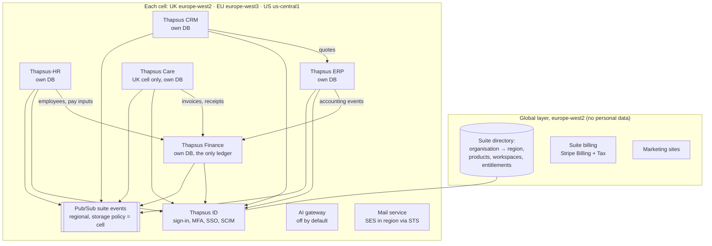

# Thapsus suite plan

> Suite document. The canonical copy is `PROJECT_ATLAS/docs/suite/`; `PROJECT_MULLAH`, `PROJECT_BOSSMAN` and
> `PROJECT_KASONGO` keep read-only mirrors. Change it in PROJECT_ATLAS, then copy it to the three mirrors in the same change.
> Status: plan for owner approval, 2026-11-07. Research behind it: each product's `docs/RESEARCH.md` and
> `docs/suite/RESEARCH_PLATFORM.md`.

## 1. The products

Thapsus Software Group sells five multi-tenant business products to other companies. They can be bought
alone or together. Bought together, they work as one suite: one sign-in, one look, no exports between them.

| Product | Codename and repository | What it does | Markets | Accent | State on 2026-11-07 |
| --- | --- | --- | --- | --- | --- |
| Thapsus-HR | `PROJECT_KAREN` | HR: people, organisation, leave, rotas, time, compliance, payroll handoff | UK, EU, US cells | Teal | Phases 0–17 built; production on Google Cloud being readied |
| Thapsus Care | `ROCHE` (Harbour) | UK adult social care: care records, medicines, safety, workforce, funding and billing | UK only | Blue | Phase 1 and 2 in build |
| Thapsus Finance | `PROJECT_MULLAH` | Accounting and finance: ledger, sales, purchases, banking, tax, reporting, close, assets, multi-entity, later UK payroll | UK first, then EU and US | Indigo (proposed) | Planned (this document) |
| Thapsus CRM | `PROJECT_BOSSMAN` | Customer relationships: sales, service, marketing, partners, customer success | UK first, then EU and US | Plum (proposed) | Planned |
| Thapsus ERP | `PROJECT_KASONGO` | Operations: inventory, warehouse, purchasing, sales orders, manufacturing (discrete and process), projects, field service, rental, quality, maintenance | UK first, then EU and US | Steel (proposed) | Planned |

"Thapsus Finance", "Thapsus CRM" and "Thapsus ERP" are working names (decision D-8 below); the owner can rename
them at any time because the names live in configuration and message catalogues.

## 2. Decisions the owner made on 2026-11-07

| # | Question | Decision |
| --- | --- | --- |
| D-1 | Markets for the three new products | UK, EU and US home-region cells from day one (as Thapsus-HR), launching with UK tax and compliance content; EU and US content follow |
| D-2 | Client size | SMB to mid-market (about 10 to 2,000 staff): self-serve for small firms, guided onboarding for mid-market. Enterprise depth (very large groups and volumes) later |
| D-3 | ERP industries first | All four: wholesale and distribution, discrete manufacturing, process manufacturing, projects and services (construction, contracting, professional and field services, rental) |
| D-4 | Payroll | Finance gets a UK payroll module in a later phase. Thapsus-HR still never runs payroll; it hands pay inputs to Finance or to other payroll software |
| D-5 | Design | One shared design system; each product keeps its own accent colour. HR and Care move onto the shared tokens over time |
| D-6 | Mobile | Installable PWAs first. A native app later, reusing Care's Expo and offline stack, for heavy offline warehouse and field-service work |
| D-7 | Build order | Shared platform kit first, then all three products in parallel. ERP builds against a contract-tested mock of Finance's ledger until Finance's ledger is ready |

Defaults taken where the owner was not asked (each can be changed by the owner; recorded in each product's
`docs/DECISIONS.md`):

| # | Topic | Default |
| --- | --- | --- |
| D-8 | Product names | Thapsus Finance, Thapsus CRM, Thapsus ERP (working names) |
| D-9 | Stack for the new products | Thapsus-HR's stack (TypeScript, pnpm and Turborepo, Next.js App Router PWA, Fastify with TypeBox and OpenAPI 3.1, PostgreSQL 17 on Cloud SQL with forced row-level security, OpenTofu cells), because the new products share HR's three-region model and most shared code is extracted from HR |
| D-10 | Shared code | The shared repository `PROJECT_ATLAS` (named and created by the owner on 2026-11-07, H-S1) publishes `@thapsus-suite/*` packages and holds the canonical suite documents. Products consume pinned versions |
| D-11 | Data ownership between products | One owner per kind of data per tenant, defaults in `INTEGRATION.md` §4 |
| D-12 | One ledger | Finance holds the only general ledger. ERP, CRM and Care send accounting events; ERP never builds its own ledger |
| D-13 | AI | Every AI feature is off by default at three levels (Thapsus availability per region, tenant owner, feature) and drafts for a person to approve; nothing changes state on model output alone (`AI.md`) |
| D-14 | Hosting | Google Cloud, one project per product per environment per cell, plus shared suite projects per cell (`PLATFORM.md` §5) |
| D-15 | Sales model | Each product sold alone, plus suite bundles with one bill per organisation (`PLATFORM.md` §8) |

Decided by the owner later on 2026-11-07:

| # | Question | Decision |
| --- | --- | --- |
| D-16 | Where the US cell runs | The owner allowed any compatible US region. The US cell moves from us-east5 (Columbus) to **us-central1 (Iowa)**, the only US region with every service the suite uses (Cloud Scheduler and Tasks, Document AI, GPUs). Backups stay in us-west1 (Oregon). Claude is reached on the us-east5 regional endpoint, still in the US. Reasons and the checked facts: `PLATFORM.md` §5.1a. Applies to Thapsus-HR too (its plan, §4a) |

## 3. Architecture at a glance

Each product is its own application with its own database, deployments and release train. They share
packages from the platform repository, not a runtime. Within a cell they talk through public APIs and the
regional event bus (`INTEGRATION.md`). Nothing crosses cells.

## 4. What every product gets from the platform kit

The kit is mostly extracted from Thapsus-HR, which already has most of these pieces in production-grade
form, and from Thapsus Care where Care's version is the stronger one.

| Area | Package | Extracted from | Notes |
| --- | --- | --- | --- |
| Regions and residency | `@thapsus-suite/core` | HR `packages/core/src/regions.ts`, `gcp.ts`, `residency.ts` | One map of cells, backup regions and AI regions; residency guard for every Google and AWS client |
| Money, time, i18n | `@thapsus-suite/core` | HR `money.ts`, `time.ts`, `i18n` | Integer minor units and ISO 4217; Temporal with IANA zones; ICU catalogues en-GB and en-US |
| Logging and tracing | `@thapsus-suite/observability` | HR `logger.ts`, `scrub.ts`, `tracing.ts` | Personal data scrubbed; regional Cloud Logging buckets only |
| Tenancy and data | `@thapsus-suite/db` | HR `packages/db` (tenant context, routing, audit, outbox, tenant move) | Forced RLS, non-owner app role, `app.tenant_id` per transaction, dedicated-database routing, isolation test harness that fails on any table without a policy |
| Audit | `@thapsus-suite/audit` | HR `audit` module and sealing | Append-only, per-tenant hash chain, export and SIEM streaming |
| Identity | `@thapsus-suite/auth` and the Thapsus ID service | HR `auth`, `scim`, `security` | Passwords, TOTP, passkeys, magic links, SAML and OIDC SSO, SCIM, sessions, step-up (`PLATFORM.md` §2) |
| Permissions | `@thapsus-suite/authz` | HR `permissions.ts`, `authz`; Care ADR-0071 (data scope per permission) | `module.resource.action` permissions, custom roles, scopes by entity, location, team; field-level security |
| Studio (no-code) | `@thapsus-suite/studio` | HR custom fields and objects, `forms`, `automation`, `workflows`, `approvals`, `tasks`, `reports`; Care forms and workflow engines | `STUDIO.md` |
| Jobs and events | `@thapsus-suite/jobs`, `@thapsus-suite/events` | HR worker (outbox, idempotent jobs, leases) | Cloud Tasks and Cloud Scheduler drive the worker's drain endpoint; Pub/Sub for suite events |
| Public API | `@thapsus-suite/api-kit` | HR `platform/http.ts`, `api-auth.ts`, webhooks | OpenAPI 3.1 from route schemas, `/v1`, OAuth client credentials, scoped keys, rate limits, idempotency keys, RFC 9457 errors, deprecation headers, signed webhooks, SDK generator |
| Documents and files | `@thapsus-suite/files` | HR documents, Care ADR-0031 (malware scanning, destruction) | Cloud Storage with CMEK, scanning, streaming downloads, retention and legal hold |
| Templates and PDFs | `@thapsus-suite/templates` | HR documents with merge fields; Care transfer-pack PDF writer | Invoice, quote, PO and letter templates, edited in Studio |
| Notifications | `@thapsus-suite/notify` | HR mail and web push; Care notification centre | Email (SES in region), web push, in-app, digest, escalation chains |
| Imports and exports | `@thapsus-suite/imports` | HR imports, data export, Care import wizard (ADR-0092) | Mapping, validation preview, background processing; full company export (EU Data Act) |
| Privacy | `@thapsus-suite/privacy` | HR privacy module; Care DSAR workbench | Subject access, erasure, retention engine, breach log, closure with deletion certificate |
| Feature flags and entitlements | `@thapsus-suite/flags` | HR `features.ts`; Care OpenFeature | OpenFeature interface, Postgres-backed provider, tenant overrides, plan entitlements from the suite directory |
| AI gateway | `@thapsus-suite/ai` | HR Ask HR (Vertex AI regional, holds, guards); Care §16 gateway design | `AI.md` |
| Design system and shell | `@thapsus-suite/tokens`, `ui`, `shell`, `charts`, `icons`, `content`, `ui-native` | HR `packages/ui`; Care `packages/ui`, `ui-native` | `DESIGN_SYSTEM.md` |
| Infrastructure | OpenTofu modules in the platform repository | HR `infra/gcp/modules`, cell and global roots, drift test, plan guard, digest promotion | `PLATFORM.md` §5 |
| Back office | `@thapsus-suite/backoffice` | HR back office (tenants, plans, flags, support access, staff trail) | One back office for every product, per cell |
| Rules packs | `@thapsus-suite/rules` | HR `packages/rules` (effective-dated, sourced, golden tests); Care rate table | Shared framework; each product owns its packs (tax for Finance, trade compliance for ERP, marketing consent for CRM) |

## 5. Roadmap

The owner chose to build the three new products in parallel after the platform kit (D-7). Months are
indicative. They follow the pace of the Thapsus-HR and Thapsus Care builds (Claude Code sessions in parallel,
owner reviews). The real critical path is the human-gated work in §6 (recognition, accreditation, contracts,
audits), which code speed does not shorten.

| Stage | Indicative window | Platform | Finance | CRM | ERP | HR and Care |
| --- | --- | --- | --- | --- | --- | --- |
| 0. Platform kit | Nov 2026 – Jan 2027 | `PROJECT_ATLAS` (its `docs/PLAN.md`, phases A0–A6 here): extract core, db, audit, auth, authz, api-kit, jobs, flags, tokens, ui, shell; Studio v1 (custom fields, objects, layouts, validation, automation); Thapsus ID v1; AI gateway skeleton (off); OpenTofu modules | Phase 0 scaffold on the kit as packages land | Phase 0 | Phase 0 | No change; HR exports its extracted modules (no behaviour change) |
| 1. Product cores | Dec 2026 – Mar 2027 | Studio v2 (workflows, approvals, templates, report builder); suite events | Ledger, sales, purchases, banking | Records, pipeline, email and calendar | Items, inventory, purchasing, sales orders against the ledger mock | — |
| 2. UK depth | Mar – Jun 2027 | Suite inbox; Thapsus ID SSO across products | UK VAT and MTD, reporting and close, expenses, fixed assets | Service desk, marketing, quotes and CPQ | Warehouse, manufacturing (discrete and process), quality, projects | Design token bridge in HR and Care |
| 3. Suite links and pilots | May – Aug 2027 | Embedded cards, capability negotiation | Posting contract live with ERP; links to HR, CRM, Care | Links to Finance, ERP, HR | Ledger mock replaced by Finance | HR: partner events, Finance and ERP links, shell and app switcher. Care: Finance as accounting target; shell |
| 4. EU and US, advanced | Aug 2027 – Mar 2028 | Suite search and analytics; native app shell (Expo) | EU VAT and e-invoicing, US sales tax and 1099s, multi-entity consolidation, revenue recognition, UK payroll | Telephony, field sales, partner portal, customer success | Field service, rental, planning, EDI, trade compliance, native warehouse app | HR: Thapsus payroll connector |
| 5. Launch readiness | From Stage 2, continuous | Load tests, threat model, ASVS L2 review, SOC 2 and ISO 27001 evidence | Same gates per product | Same | Same | — |

**First sellable releases (UK):** Finance after Stage 2 (ledger, sales, purchases, banking, VAT with MTD,
reporting and close); CRM after Stage 2 (sales, service, basic marketing); ERP after Stage 2 for wholesale
and distribution, then discrete and process manufacturing, then projects and services.

## 6. Human-gated critical path

These take calendar time that code cannot shorten. Each product's `docs/HUMAN_TODO.md` holds the exact steps.

| Item | Product | Why it gates | Start by |
| --- | --- | --- | --- |
| Shared repository (**done 2026-11-07: `PROJECT_ATLAS`**) and its Artifact Registry npm repository (still to create) | All | Nothing shared can be published without it | Stage 0, week 1 |
| Google Cloud projects, folders, organisation policies and billing per product and cell | All | Staging and production | Stage 0 |
| HMRC developer hub, MTD VAT sandbox and production credentials, recognition listing | Finance | UK launch | Stage 1 |
| Open banking aggregator contract (UK first) and its DPA | Finance | Bank feeds | Stage 1 |
| Payments partner (GoCardless, Stripe) platform agreements | Finance, CRM | Collecting money | Stage 1 |
| Peppol service-provider route (own accreditation or a certified partner) | Finance | EU e-invoicing | Stage 2 |
| Tax engine partner for US sales tax | Finance, ERP | US launch | Stage 3 |
| Email sending reputation for CRM marketing (dedicated domains and IPs, SES production access per region) | CRM | Marketing email | Stage 2 |
| Telephony and WhatsApp Business partner accounts | CRM | Calls and messaging | Stage 3 |
| Carrier and shipping aggregator accounts | ERP | Labels and tracking | Stage 2 |
| HMRC RTI recognition and payroll test scenarios; pension provider APIs | Finance | UK payroll | Stage 3 |
| SOC 2 Type II observation window and ISO 27001 certification | All | Mid-market buyers ask for it | Stage 2 |
| Legal review of DPAs, sub-processor lists, AI terms per region | All | Before any customer data | Stage 1 |
| Design partners: at least two pilot customers per product | All | Proves fit before general release | Stage 2 |

## 7. Risks

| Risk | Effect | Mitigation |
| --- | --- | --- |
| Three products in parallel stretch review capacity | Slow merges, drift from the plan | One lead session coordinates; one session per product lane plus one platform lane; weekly owner review of each product's PROGRESS; strict phase acceptance criteria |
| The platform kit becomes a bottleneck | Products wait | Products start on HR's code copied behind the same interfaces, then switch to the kit packages; kit releases weekly |
| Ledger correctness | Financial misstatement is the worst failure mode | Tests first for every posting rule; database-enforced invariants (balanced, immutable, period locks); property-based tests; reconciliation jobs; accountant review in pilots |
| Regulatory scope (EU e-invoicing differs per country) | EU launch slips | Country-by-country packs on one e-invoicing framework; a certified Peppol and clearance partner instead of building every national integration; publish coverage per country |
| ERP breadth across four industries | Shallow product | Shared core first; each industry as a Studio solution pack with its own acceptance criteria; launch with wholesale first and add the others one by one |
| Design convergence disrupts HR and Care | Visual regressions | Token bridge with visual diff review; no accent change; staged adoption |
| AI regional availability on Google Cloud | No Claude model in London or Frankfurt; newer models are global or multi-region only; regional models retire | Region map with legal holds (as HR ADR-0248); Gemini in-region in the UK and EU; per-feature evaluation suites so a feature can change model per cell; deterministic non-AI path for every feature (`AI.md` §4) |
| Google services missing in a cell region | Cloud Scheduler and Cloud Tasks are not offered in us-east5 (checked 2026-11-07), so a US cell there would fail to deploy | Resolved by D-16: the US cell moves to us-central1, which has them. Thapsus-HR's US cell, not yet deployed, moves too (its plan §4a; the lead session has the change list). Any service a product adds is checked in all three cell regions first |
| EU Data Act switching rules | From 12 January 2027 no switching charges; contracts need notice, transition, retrieval and export terms; configuration counts as exportable data | Full export, including configuration, in every product's Phase 0 acceptance; contract terms through legal review (HUMAN_TODO_SUITE H-S7) |
| Cost of many Cloud SQL instances | Spend above plan | Shared suite projects; right-sized staging; deploy EU and US production cells only when the first customer there signs; ask before adding recurring cost |

## 8. How the build is run

- One **lead session** coordinates the suite, merges batches and keeps this plan current.
- One **platform session** builds `PROJECT_ATLAS`; one **product session** per new product; HR and Care keep
  their own sessions, which take suite work only as planned slices.
- Each product repository has its own `CLAUDE.md`, `docs/BUILD_BRIEF.md`, `docs/PLAN.md` (phases with
  acceptance criteria), `docs/DECISIONS.md`, `docs/HUMAN_TODO.md` and `docs/RESEARCH.md`.
- Suite documents are changed only in `PROJECT_ATLAS/docs/suite/` (the canonical copy) and then copied, in the same
  change, to the read-only mirrors in the three product repositories.
- Work goes phase by phase; a phase is done only when its acceptance criteria are proved by tests or checks,
  with human-only items recorded in HUMAN_TODO.

## 9. Suite documents

| Document | Contents |
| --- | --- |
| `SUITE_PLAN.md` | This overview, decisions, roadmap, critical path, risks |
| `INTEGRATION.md` | How the products work together: ownership, events, flows, the posting contract |
| `PLATFORM.md` | Identity, tenancy, security, hosting on Google Cloud, compliance, billing, operations |
| `STUDIO.md` | No-code customisation for clients |
| `AI.md` | Optional AI features and their guardrails |
| `DESIGN_SYSTEM.md` | One UI across all products |
| `HUMAN_TODO_SUITE.md` | Steps only a person can take for the whole suite |
| `RESEARCH_PLATFORM.md` | Research behind the platform choices, with sources |

PROJECT_ATLAS has its own `docs/PLAN.md` for the platform kit (phases A0 to A11). Each product repository adds its
own `docs/PLAN.md`, `docs/FEATURES.md`, `docs/BUILD_BRIEF.md` (draft),
`docs/RESEARCH.md`, `docs/DECISIONS.md` and `docs/HUMAN_TODO.md`. Thapsus-HR and Thapsus Care have their own plans for
joining the suite: `PROJECT_KAREN/docs/SUITE_INTEGRATION_PLAN.md` and `ROCHE/docs/plans/thapsus-suite.md`.
